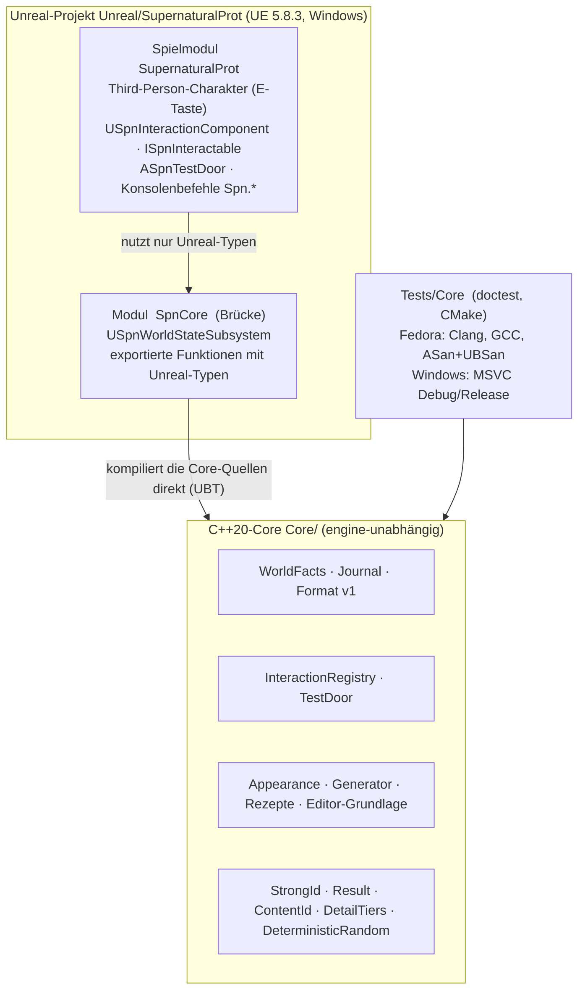

# Supernatural 3D Game C++

**Ein langfristig angelegtes, übernatürliches Open-World-Spiel: düsterer Monsterjäger-Horror in einer lebendigen, persistenten Welt, entwickelt mit Unreal Engine und einem eigenen, engine-unabhängigen C++20-Core.**

> [!IMPORTANT]
> Das Projekt befindet sich in **Phase 0 („Core Technology“)**. Spielbar ist derzeit ein **technischer Prototyp**: eine als Platzhalter gekennzeichnete Testkarte mit drei Testtüren, die per **E** geöffnet und geschlossen werden und deren Zustand gespeichert und geladen werden kann. **Alles, was in dieser README über Geschichte, Welt, Kreaturen, Fahrzeuge, Mehrspieler oder den optionalen Erwachsenen-Bereich steht, ist Planung oder Vision und kein spielbarer Inhalt.** Jede Aussage trägt eine Statuskennzeichnung (siehe unten).

| | |
|---|---|
| **Entwicklungsstand** | Phase 0, Core Technology (Prototyp, noch kein Spiel im eigentlichen Sinn) |
| **Technik** | Unreal Engine 5.8.3 (Windows) · C++20-Core mit CMake (Fedora und Windows) |
| **Tests** | 181 Core-Testfälle (doctest), am 2026-10-20 unter Windows/MSVC Debug erneut bestanden · 10 Unreal-Automation-Tests (zuletzt dokumentierter Stand) |
| **Lizenz** | **noch nicht festgelegt**, siehe [Kapitel 31](#31-open-source-lizenzstatus-drittanbieter-assets-und-rechteprüfung) |
| **Stand dieser README** | 2026-10-20, auf Basis von Commit `dd47da8` |

---

## Über dieses Dokument

Diese README ist zugleich **Vorstellung des geplanten Spiels** und **technische Projektdokumentation**. Sie ist eigenständig lesbar: Alle Kernaussagen zur Spielvision stehen hier selbst. Vertiefungen liegen in eigens aufbereiteten Dokumenten im Repository ([`Docs/Game/`](Docs/Game/)); technische Entscheidungen stehen in [`Docs/Decisions/`](Docs/Decisions/).

### Status-Kennzeichnung

Jede Aussage über das Spiel ist mit einem Status versehen. Die Unterscheidung ist das wichtigste Qualitätsmerkmal dieser README: Sie soll zeigen, wie groß das Vorhaben ist, ohne den tatsächlichen Stand zu verschleiern.

| Kennzeichnung | Bedeutung |
|---|---|
| ✅ **Implementiert** | Im Repository vorhanden, gebaut und durch Tests abgedeckt. |
| 📋 **Fest geplant** | Vom Entwickler bestätigte Richtung oder Entscheidung, aber noch nicht umgesetzt. |
| 🧭 **Vorläufig** | Arbeitsstand, Testszenario oder Beispiel. Darf nicht als Festlegung gelesen werden. |
| 🔭 **Vision** | Langfristiges Ziel ohne konkrete Spezifikation. |
| ❓ **Offen** | Ausdrücklich nicht entschieden. |
| 🕰️ **Überholt** | Frühere Planung, die später ersetzt wurde (nur zur Einordnung genannt). |

### Woher die Planung stammt

Das Projekt hat einen sehr umfangreichen **Planungsmaster** (rund 3 GB; mehrere tausend Dokumente, Karten, Geodaten und Gesprächsprotokolle). Er liegt **außerhalb dieses Repositorys**, bleibt unverändert und wird hier nicht verlinkt. Für die Vision-Kapitel wurden die maßgeblichen Teile gelesen und eigenständig aufbereitet. Dabei gelten feste Regeln:

- **Spätere ausdrückliche Entscheidungen des Entwicklers gehen vor.** Ältere Planung bleibt Geschichte und wird nicht als aktuell dargestellt.
- **Beispiele, Schätzungen und Vorschläge von Assistenten werden nicht zu Entscheidungen.**
- Wo sich Planungsstände widersprechen, steht der Widerspruch ausdrücklich dabei. Die Gesamtübersicht liefert [Entscheidungsstatus](Docs/Game/Entscheidungsstatus.md).
- Es wird **nicht behauptet**, den gesamten Master geprüft zu haben. Die Tiefe der Aufbereitung je Themenbereich und der Stand der Recherche stehen in [Kapitel 32](#32-mitwirken-dokumentation-und-weiterführende-informationen).

### Vertiefende Dokumente zur Spielplanung

| Dokument | Inhalt |
|---|---|
| [Spielvision](Docs/Game/Spielvision.md) | Ton, Hauptgeschichte, Protagonist und Crew, Fälle, Ermittlung, Hunter-Archiv, Kreaturen, Fortschritt, Modi, Dialog |
| [Spielwelt und Untergrund](Docs/Game/Spielwelt-und-Untergrund.md) | Größenplanung, Geografie, Metropolis und Städte, Zeitreise, Natur, Aktivitäten, Verkehr, Untergrund, Reiche |
| [Gameplay-Systeme](Docs/Game/Gameplay-Systeme.md) | Verletzung, Waffen, Nahkampf, Fahrzeuge, Tarn-KI, NPCs, Körper, Recht, Smartphone, Editor, Wirtschaft, Modding |
| [Adult-System](Docs/Game/Adult-System.md) | der optionale Erwachsenen-Bereich im Planungsstand |
| [Entscheidungsstatus](Docs/Game/Entscheidungsstatus.md) | bestätigt, vorläufig, offen, überholt, Widersprüche |

---

## Inhaltsverzeichnis

**Teil I: Das Spiel**

1. [Projektvorstellung und langfristige Vision](#1-projektvorstellung-und-langfristige-vision)
2. [Genre, Ton und Spielgefühl](#2-genre-ton-und-spielgefühl)
3. [Der Spielablauf eines Falls](#3-der-spielablauf-eines-falls)
4. [Story und Erzählstruktur](#4-story-und-erzählstruktur)
5. [Protagonist, Crew und Hauptquartier](#5-protagonist-crew-und-hauptquartier)
6. [Fälle, Ermittlung und das Hunter-Archiv](#6-fälle-ermittlung-und-das-hunter-archiv)
7. [Kreaturen und das Übernatürliche](#7-kreaturen-und-das-übernatürliche)
8. [Nebeninhalte, Aktivitäten und dynamische Ereignisse](#8-nebeninhalte-aktivitäten-und-dynamische-ereignisse)
9. [Die Spielwelt](#9-die-spielwelt)
10. [Metropolis und die Städte](#10-metropolis-und-die-städte)
11. [Die Untergrundzivilisation](#11-die-untergrundzivilisation)
12. [Himmel, Hölle und Fegefeuer](#12-himmel-hölle-und-fegefeuer)
13. [NPCs, Gesellschaft und Beziehungen](#13-npcs-gesellschaft-und-beziehungen)
14. [Kampf, Verletzungen und Medizin](#14-kampf-verletzungen-und-medizin)
15. [Fahrzeuge, Bahn und Fortbewegung](#15-fahrzeuge-bahn-und-fortbewegung)
16. [Wirtschaft, Recht und Smartphone](#16-wirtschaft-recht-und-smartphone)
17. [Fortschritt, Medaillen und Erfolge](#17-fortschritt-medaillen-und-erfolge)
18. [Koop, Online und Plattformen](#18-koop-online-und-plattformen)
19. [Charaktereditor und Menschen](#19-charaktereditor-und-menschen)
20. [Grafik, Animation, Audio und Immersion](#20-grafik-animation-audio-und-immersion)
21. [Das Adult-System: optional und modular](#21-das-adult-system-optional-und-modular)
22. [Modding und Erweiterbarkeit](#22-modding-und-erweiterbarkeit)

**Teil II: Technik und Entwicklung**

23. [Technische Vision](#23-technische-vision)
24. [Technische Architektur: C++20-Core und Unreal Engine](#24-technische-architektur-c20-core-und-unreal-engine)
25. [Persistenz, WorldFacts, Save-System und Weltzustände](#25-persistenz-worldfacts-save-system-und-weltzustände)
26. [Aktueller Implementierungsstand](#26-aktueller-implementierungsstand)
27. [Entwicklungsphasen, Roadmap und Meilensteine](#27-entwicklungsphasen-roadmap-und-meilensteine)
28. [Installation, Voraussetzungen, Build und Tests](#28-installation-voraussetzungen-build-und-tests)
29. [Projektstruktur und wichtige Verzeichnisse](#29-projektstruktur-und-wichtige-verzeichnisse)
30. [Entwicklungsrichtlinien und Qualitätssicherung](#30-entwicklungsrichtlinien-und-qualitätssicherung)
31. [Open Source, Lizenzstatus, Drittanbieter-Assets und Rechteprüfung](#31-open-source-lizenzstatus-drittanbieter-assets-und-rechteprüfung)
32. [Mitwirken, Dokumentation und weiterführende Informationen](#32-mitwirken-dokumentation-und-weiterführende-informationen)

[Anhang A: Glossar](#anhang-a--glossar) · [Anhang B: Offene Entscheidungen im Überblick](#anhang-b--offene-entscheidungen-im-überblick)

---

# Teil I: Das Spiel

## 1. Projektvorstellung und langfristige Vision

**Supernatural 3D Game C++** (Arbeitstitel; der endgültige Titel ist ❓ offen) soll ein **eigenständiges, realistisches 3D-Spiel über Monsterjäger** im modernen Amerika werden: ein Open-World-Action-Adventure mit der Tiefe eines Rollenspiels, der Methodik eines Detektivspiels, den Systemen einer Immersive Sim und der Anspannung eines Survival-Horror-Spiels. Die Welt ist unsere, mit einem entscheidenden Unterschied: Das Übernatürliche existiert, bleibt aber für die breite Bevölkerung verborgen, falsch erklärt oder vertuscht.

Das Spiel ist eine **originale Marke**. Es speist sich aus der Tradition amerikanischer Roadtrip- und Monsterjagd-Geschichten, übernimmt aber keine Namen, Figuren, Waffen, Symbole, Lore, Kosmologie, Geschichten oder Designs bestehender Werke. Vor einer Veröffentlichung ist eine rechtliche Markenprüfung vorgesehen.

### 1.1 Worum es geht

Man spielt einen **selbst erstellten Jäger**, der zu einer festen Crew gehört, durch eine große, glaubwürdige Welt fährt, Spuren folgt, Zeugen befragt, Beweise sammelt, in einem wachsenden Archiv recherchiert, sich vorbereitet und schließlich einer Kreatur gegenübertritt, deren Regeln man erst verstehen muss. Jede Handlung hinterlässt Spuren in einer **persistenten Welt**: Wer stirbt, bleibt tot; ein zerstörtes Nest bleibt zerstört; ein ignorierter Fall fordert Opfer.

### 1.2 Was das Projekt besonders machen soll

- 📋 **Eine Welt, die weiterläuft.** NPCs haben Tagesabläufe, Erinnerungen, Beziehungen und Alterung; Wirtschaft, Sport, Kriminalität und Wetter laufen unabhängig vom Spieler.
- 📋 **Ermittlung statt Markerjagd.** Der Detektivmodus verzichtet vollständig auf automatische Hilfe. Fälle haben mehrere gültige Lösungswege.
- 📋 **Wissen als Waffe.** Die richtige Waffe, die richtige Munition und die Schwäche der Kreatur entscheiden. Es gibt keine Kugelschwämme, keine sichtbaren Monsterlevel und keine Beute-Seltenheitsfarben.
- 📋 **Körper mit Konsequenzen.** Ein tiefes Verletzungs- und Medizinsystem: Spieler und Menschen teilen dieselbe Anatomie, es gibt keine Plot-Rüstung und keine Sofortheilung.
- 📋 **Fahren als Handwerk.** Manuelle Kupplung, Abwürgen, freie Gangwahl, eine Fahrphysik mit Antriebsstrang, Reifen und Last.
- 📋 **Ein Weltumfang, der weit über das Jagen hinausgeht.** Motorsport, Sport und Wetten, Immobilien, Hausbau, Jagd, Angeln, Tauchen, Wintersport, Nachtleben, Jobs und vieles mehr, ohne dass der Spieler in eine Klasse gesperrt wird.
- 📋 **Realismus und innere Konsistenz** als eine der höchsten Prioritäten des ganzen Projekts.
- 🔭 **Mehrspieler und Modding** als gleichrangige Richtung: bis zu vier Spieler in der Kampagne, anbieterunabhängiges Modding.

### 1.3 Grundsätze der Entwicklung

- **Die volle Langzeitvision bleibt erhalten.** Entwicklungsphasen legen die *Reihenfolge* fest, nicht dauerhafte Streichungen. Was fehlt, ist verschoben, nicht verworfen.
- **Vertikal statt horizontal.** Kleine, spielbare, testbare Schritte; Planung und Umsetzung laufen parallel.
- **Datengetrieben und austauschbar.** Weltgröße, Karte und Inhalte sind nicht festgelegt; Systeme werden so gebaut, dass spätere Änderungen keine Neuentwicklung erzwingen.
- **Persistenz als Fundament.** Große Handlungen verändern die Welt dauerhaft ([Kapitel 25](#25-persistenz-worldfacts-save-system-und-weltzustände)).
- **KI-gestützte Entwicklung unter menschlicher Freigabe.** Ein Entwickler (etwa 8–15 Stunden pro Woche) leitet das Projekt; KI-Werkzeuge arbeiten als Ingenieur-Mitarbeiter. Technische Prüfung ersetzt nie die kreative Freigabe.
- **Offenheit.** Langfristig soll das Projekt Open Source werden, unter klaren Bedingungen ([Kapitel 31](#31-open-source-lizenzstatus-drittanbieter-assets-und-rechteprüfung)).

### 1.4 Was ausdrücklich nicht festgelegt ist

Für den Arbeitsbeginn wird nichts davon endgültig entschieden:

- ❓ Die finale Fläche der Hauptwelt (siehe [Kapitel 9](#9-die-spielwelt)) und die finale Karte.
- ❓ Terrain, Gewässer, Gebirge, Küsten, Straßen, Siedlungszahl, Stadtgrößen, Bezirke und deren Platzierung.
- ❓ Die vollständige Handlung, Missionsreihenfolge, die Crew-Besetzung und lore-spezifische Orte.
- ❓ Größe, Bevölkerung und Geometrie der Untergrundstadt sowie weitere reservierte Story-Fragen.
- ❓ Zahlenwerte für Gameplay, Fahrverhalten, KI und Simulation.

Eine Gesamtliste steht in [Anhang B](#anhang-b--offene-entscheidungen-im-überblick) und detaillierter in [Entscheidungsstatus](Docs/Game/Entscheidungsstatus.md).

---

## 2. Genre, Ton und Spielgefühl

### 2.1 Genre

📋 **Open-World-Supernatural-Action-Adventure**, verstärkt durch tiefe Rollenspiel-, Ermittlungs-, Immersive-Sim- und Survival-Horror-Systeme. Die Rollenspieltiefe kommt aus **Entscheidungen, Beziehungen, Konsequenzen, Ermittlung, Vorbereitung, Ausrüstung, Wissen und organischem Fertigkeitswachstum**, nicht aus Stufen und Zahlen.

Vermieden werden ausdrücklich: sichtbare Monster- oder Charakterlevel, farbcodierte Beute-Seltenheit, an Stufen gebundene Gegner, automatische Gegnerskalierung und abstrakte Schadenszahlen. Die Bedrohung ergibt sich aus den Regeln der Kreatur, ihrem Wissen, der Umgebung, Verletzungen, der Gegnerzahl und der taktischen Lage.

### 2.2 Ton

📋 Der Grundton ist **düsterer Mystery-Horror** nach dem Vorbild der frühen Phase des Genres, als Ton- und Genre-Referenz für die eigene Marke:

- dunklere Nächte und Innenräume, wenig ausgeleuchtetes Low-Key-Licht,
- schmutzige Motels, Nebenstraßen, Tankstellen, Wälder und alte Häuser,
- Monster zunächst **bedrohlich und unbekannt**; Ermittlung vor der großen Enthüllung,
- weniger Fantasy-Spektakel im Alltag; Regen, Nebel, nasse Straßen, Neonlicht, praktische Lichtquellen,
- Sounddesign mit Stille, fernen Geräuschen und Spannung,
- Horror darf unangenehm sein; die Welt bleibt modern und realistisch.

Späterer Umfang (mächtigere Gegner, größere Lore, andere Dimensionen) ist ausdrücklich vorgesehen und erscheint durch diese dunkle Linse: *später großer Umfang, früher Horror-Ton*.

### 2.3 Systemischer Horror

📋 Horror soll nicht aus Skripten entstehen, sondern **aus Systemen**: aus Unsicherheit, Geräuschen, Dunkelheit, Strom und Licht, Türen, Wetter und KI-Verhalten. Kreaturen können Lichter und Stromversorgung manipulieren; Taschenlampen sind Werkzeug und Risiko zugleich; Türen haben akustische Ergebnisse (alte Türen knarren, selbst bei vorsichtigem Öffnen).

---

## 3. Der Spielablauf eines Falls

📋 Der erste große Meilenstein, der **Vertical Slice** (Phase 1), ist als **ein vollständiger übernatürlicher Fall** geplant (🧭 etwa 30–60 Minuten, etwa 1–3 km²):


1. **Ankunft.** Der Spieler fährt zu einem Schauplatz. Die Fahrt ist selbst Spielzeit: Gespräche mit Begleitern, Radio, Telefon, Schweigen.
2. **Dialog.** Befragung von Zeugen und Betroffenen; Aussagen sind Information, keine garantierte Wahrheit.
3. **Ermittlung.** Spuren, Beweise, Orte, Zeitleisten. Ein Fall darf gelöst werden, sobald genug richtige Hinweise vorliegen.
4. **Recherche.** Das Hunter-Archiv verknüpft Fundstücke mit Wissen über Kreaturen, Orte und Geschichte, auch mit falschem oder veraltetem Wissen.
5. **Vorbereitung.** Ausrüstung, Waffen, Munition, Rituale, Plan mit dem Begleiter. Die Vorbereitung vor der Jagd zählt.
6. **Konfrontation.** Die Kreatur wird unter Ausnutzung ihrer Schwäche gestellt, sei es durch Töten, Vertreiben, Bannen, Fangen, Fluch brechen, Verhandeln oder Evakuieren.
7. **Konsequenzen.** Das Ergebnis wird in der Welt und im Fall-Journal festgehalten und wirkt nach.

---

## 4. Story und Erzählstruktur

> [!NOTE]
> Es gibt **keine ausgearbeitete Endfassung der Handlung**. Dieses Kapitel beschreibt Aufbau, Prinzipien und das, was feststeht. Zentrale Enthüllungen der Hauptgeschichte werden bewusst nicht vorweggenommen. Ausführlicher: [Spielvision](Docs/Game/Spielvision.md).

### 4.1 Der Anfang

📋 Das Spiel beginnt **bewusst klein und düster**: in einem **ländlichen Gebiet**, mit einer **persönlichen, tragischen Vergangenheit** des Protagonisten, die die Geschichte ins Rollen bringt. Es folgen erste lokale Fälle, ein wachsendes Verständnis der übernatürlichen Welt, weitere Regionen und größere Zusammenhänge. Eine große Jäger-Organisation, ein Supercomputer oder ein Artefaktlager stehen **nicht** am Anfang. Der Spieler beginnt mit wenig übernatürlichem Wissen. Ein großes Hauptquartier wird **erst nach mehreren Stunden Hauptgeschichte entdeckt**; die Entdeckung soll ein bedeutender Moment sein.

❓ Das genaue auslösende Ereignis und die Vergangenheit des Protagonisten sind offen.

### 4.2 Aufbau

- 📋 Die Hauptgeschichte ist in **Akte und Kapitel** gegliedert. Aktwechsel markieren große Phasen; Kapitelwechsel können Welt, Crew, Dialoge, Hauptquartier und verfügbare Inhalte verändern.
- 📋 Ein Akt kreist oft um eine **große, langlaufende Bedrohung**. Sie wird nicht in einer Mission eingeführt und erledigt, sondern wirkt über Handlanger, Hinweise, frühe Begegnungen, gescheiterte Versuche und wechselnde Strategien. Der Spieler kann mehrere Begegnungen überleben, bevor er versteht, wie sie wirklich zu besiegen ist. Eine vermeintliche Hauptbedrohung kann sich später als Teil eines größeren Problems erweisen.
- 📋 Es gibt eine **stabile Handlungsachse**. Große Ereignisse bleiben konsistent; Spielerentscheidungen verändern vor allem das **Wie**: Ermittlungswege, Routen, Dialoge, Informationen, optionale Ziele, kleinere NPC-Schicksale, Belohnungen, Beziehungen und Verletzungen. Zentrale Todesfälle sind bewusst geschriebene Ereignisse. Es gibt keine unkontrollierte Verzweigungs-Explosion.
- 📋 **Hauptmissionen sind nie dauerhaft verpassbar**, Nebenmissionen normalerweise auch nicht (seltene logische Ausnahmen, etwa der Tod einer Person).
- 📋 **Regionen sind vor ihrem Handlungsbogen erkundbar.** Missionen sind durch Zustand und Abhängigkeiten freigeschaltet, nicht durch geografische Sperren. Die Verfügbarkeit folgt einem Abhängigkeitsgraphen (Akt, frühere Missionen, Weltzustand, Beziehungen, Wissen, Ort, Zeit, Ergebnis).
- 🧭 Geplanter Umfang der Hauptgeschichte: etwa **80–100 Stunden** (Planungsziel vom 31. August 2026).

### 4.3 Hintergrund der Welt

- 📋 Das Übernatürliche ist **öffentlich unbewiesen**; das Internet ist voll mit Fälschungen und Rauschen. Es gibt **keinen universellen Gedächtnisverlust** der Welt; öffentliche Meinung kann sich über Jahre verschieben.
- 📋 Die Welt hat eine **mehrhundertjährige verborgene Geschichte**: Gemeinschaften, Jägerfamilien, okkulte Gelehrte, geheime Archive, Kriegszeit-Programme und rivalisierende Organisationen besitzen jeweils Wissensfragmente. Historische Konfliktschichten sind in originaler Form nutzbar.
- 📋 **Zeitreise** ist als großes Spielsystem geplant (siehe [Kapitel 9.6](#96-zeitreise)).

### 4.4 Was offen ist

❓ Akt- und Kapitelzahl, vollständige Gliederung, benannte Bedrohungen, Kosmologie, Antagonisten, Fraktionen, Regionsabfolge, Endspiel, Besetzung der Crew.

---

## 5. Protagonist, Crew und Hauptquartier

### 5.1 Der Protagonist

📋 Es gibt **einen frei erstellbaren Hauptcharakter**, männlich oder weiblich, ohne Story- oder Inhaltssperren. Realistische körperliche Unterschiede dürfen Grundwerte beeinflussen, aber weder einen Pauschalnachteil noch Sperren erzeugen: Leistung ergibt sich aus dem tatsächlichen Körper-, Trainings- und Verletzungszustand. Ein Wechsel zwischen mehreren spielbaren Hauptfiguren ist nicht das Kernmodell.

### 5.2 Die Crew

- 📋 Der Protagonist gehört zu einer festen **Hunter-Crew**, einer familienähnlichen Gruppe. Die soziale Dichte großer Gruppen in bekannten Epen dient als Referenz, nicht als Vorlage.
- 📋 Crew-Mitglieder sind **ausgearbeitete Figuren** mit Persönlichkeit, Vergangenheit, Beziehungen, Konflikten, Tagesabläufen, Fähigkeiten, Fahrzeugen, Zimmern, Ausrüstung, Meinungen, Kontakten und Erinnerungen.
- 📋 Viele große Missionen laufen mit mindestens einem Crew-Mitglied; **Solo-Abschnitte** bleiben für Horror und persönliche Geschichte. Das Spiel beginnt mit einem Zwei-Jäger-Kern.
- 📋 Gewöhnliche Begleiter können **dauerhaft sterben**; handlungskritische Figuren sind vor Zufallstod geschützt, geschriebene Todesfälle sind endgültig. Persönliche Anfragen der Crew haben mehrere faire Auslöser.
- 📋 **Begleiter-Autonomie:** Begleiter sind eigenständige Akteure. Vor einem Einsatz kann man mit ihnen planen (Rollen, Eingänge, laut oder leise, Rückzug, Treffpunkt); im Einsatz gibt man Befehle und Handzeichen (folgen, warten, decken, flankieren, Ausgang sichern, zurückziehen, leise sein), notfalls per Funk. Sie weichen nur bei unmittelbarer Gefahr oder neuer Information ab. Ein **Hund** kann Begleiter sein (Training, Spurensuche, Pflege).
- ❓ Besetzung, Biografien, Spezialisierungen und Beziehungen der Crew.

### 5.3 Das Hauptquartier

📋 Ein dauerhaftes, **wachsendes Hauptquartier** ist das emotionale Zentrum: Schlafräume, Küche, Garage, Waffenraum, Archiv, Werkstatt, Training, Krankenzimmer, Sicherheitsräume, Lager, Forschung. Die Crew lebt dort (essen, trainieren, recherchieren, streiten, feiern). Versorgung soll organisch ablaufen, ohne Verwaltungszwang. Für entfernte Handlungsbögen dienen **Feldbasen** (Motels, Hütten, Unterschlupfe) und ein kleines mobiles Wildnislager. Auf der öffentlichen Spielerkarte wird das Hauptquartier nicht auffällig beschriftet.

❓ Ort, Aufbau, Ausbaufolge und mögliche Umzüge.

---

## 6. Fälle, Ermittlung und das Hunter-Archiv

### 6.1 Fälle

📋 Zahlreiche hochwertige Nebenfälle sollen wie eigenständige „Monster der Woche“-Episoden wirken: **echte Mehrwege-Ermittlungen** ohne unnötige versteckte Pflichtziele. Verschiedene Informationswege können zu einer gültigen Lösung führen, falsche oder verfrühte Schlüsse können Folgen haben. Beginn, Hinweismuster, Orte, Opfermuster, Recherchepfad, Monsterverhalten, Wendungen und Auflösung variieren stark. Es gibt falsche Alarme, mehrdeutige Fälle und Mischungen aus gewöhnlicher Kriminalität und Übernatürlichem. Das **Fall-Journal** hält den tatsächlichen Ermittlungsweg, Entscheidungen, Vorbereitung und Folgen fest; optional zeigt es eine alternative Referenzlösung, nie als einzig richtigen Weg.

Zusätzlich gibt es **Detektivarbeit ohne Übernatürliches** (Vermisste, Betrug, Brandstiftung, Mord, ungelöste Altfälle, Korruption, Cyberkriminalität) mit Befragung, Observation, Verfolgung, Abhören, Überwachungskameras, Recherche, Forensik und Informanten; Fälle können scheitern oder falsch geschlossen werden. Eine optionale Privatdetektiv-Laufbahn ist gewünscht.

### 6.2 Ermittlungsmodi

📋 Der **Detektivmodus** ist kompromisslos: keine Questmarker, Suchzonen, hervorgehobenen Objekte, automatischen Schlüsse, Hypothesenvorschläge oder Beweiszähler. Der Spieler markiert und verknüpft selbst. **Geführte Modi** ergänzen Hilfe schrittweise. Die Ermittlungsführung ist unabhängig vom Kampf-Schwierigkeitsgrad einstellbar.

### 6.3 Beweise und Forensik

📋 Spuren (Fußabdrücke, Blut, Reifen, Schleifspuren, Vegetation, Haare, Geruch) werden vom Wetter abgebaut, vom Schnee verändert und können manipuliert oder falsch gedeutet werden. Forensik umfasst Fingerabdrücke, DNA, Ballistik, Fasern, Toxikologie, Todeszeitfenster, Autopsien und Labore mit Bearbeitungszeit, samt Mehrdeutigkeit und übernatürlichen Anomalien.

### 6.4 Das Hunter-Archiv

📋 Das Archiv ist ein **Wissens- und Entdeckungsgraph**, der Orte, Straßen, Gebäude, Personen, Monster, Flüche, Rituale, Symbole, Artefakte, Waffen, Fälle, Dokumente, Fotos, Audio, Zeitungen, Polizeiberichte, Zeugenaussagen und Anomalien verknüpft.

- Es zeigt **entdecktes Wissen**, keine internen Daten. Aussagen sind *bestätigt, vermutet, umstritten, widerlegt* oder *historisch/unverifiziert*. Jägerbücher, Legenden und erfahrene Jäger können sich irren; Beobachtung und Tests berichtigen das Archiv.
- **Qualitative Wissensanzeige** statt ständiger Prozentzahlen; unbekannte Inhalte verraten ihre Kategorie nicht.
- Hierarchische Karte: Welt → Region → Stadt → Bezirk → Straße/Ort → Gebäude.
- Ein Fortschrittsmenü (Hunter-Aufzeichnung) für Geschichte, Fälle, ungelöste Fälle, Monster, Orte, Sammelobjekte, Artefakte, Waffen, Rituale und Personen. Der Monsterstatus ist reicher als „getötet“ (begegnet, identifiziert, erforscht, vertrieben, gebannt, gefangen, getötet, Fluch gebrochen).
- ❓ Sammelobjekte: Ein früherer Plan sah etwa 1.200–1.500 vor, bezogen auf ein viel kleineres Weltkonzept (🕰️). Für die heutige Welt sind die Zahlen offen und werden je Kategorie neu zugeordnet.

### 6.5 Organische Fallentstehung

📋 Fälle erscheinen nicht wie ein Quest-Spawn. Weltzustände haben **glaubwürdige Vorlaufphasen** (Zeitungsmeldungen, Vermisstenanzeigen, Polizeifunk, Gerüchte, Tierverhalten, Anomalien), die sich zu einem Muster verdichten. Wer ein sich entwickelndes Ereignis ignoriert, riskiert Folgen: weitere Opfer, Polizeieinsatz, Eingreifen eines anderen Jägers, Abwandern der Kreatur, veränderte Beweise oder einen späteren Altfall.

---

## 7. Kreaturen und das Übernatürliche

### 7.1 Klassifikation statt Stufen

📋 Kreaturen werden mehrdimensional beschrieben: **Existenzform** (körperlich, verwandelter oder besessener Mensch, geistähnlich, gebunden), **Herkunft** (natürlich, verflucht, erschaffen, beschworen, dimensional, unbekannt), **Intelligenz** (Problemlösen, Soziales, Taktik, Gedächtnis, Sprache, Selbstkontrolle), **Motivation** (Hunger, Revier, Rache, Schutz, Fluchzwang, Neugier, Ritual ...) und **Temperament**. Alter und Erfahrung sind getrennt: Uralte Wesen sind durch Wissen gefährlich, nicht durch aufgeblähte Lebenspunkte. Außergewöhnliche Individuen können die Standardschwäche ihrer Art teilweise überwinden; der Spieler erfährt es durch Beobachtung und Recherche, nicht durch Beschriftungen.

### 7.2 Schwächen und Anatomie

📋 Schwächen wirken nicht nur als Bonusschaden: Sie können tödlich sein, die Regeneration unterdrücken, abwehren, lähmen, Schutz brechen, die wahre Gestalt enthüllen oder Fähigkeiten stören. Anatomie ist artspezifisch und modular; zerstörte Gliedmaßen beeinträchtigen die Bewegung, solange keine Regenerationsregel greift. Regeneration ist in Rate, Gewebe, Ressourcen, Bedingungen, Unterdrücker und Grenzen zerlegt. Narben bleiben bestehen; wiederkehrende Individuen sind an früheren Kämpfen erkennbar.

### 7.3 Lebendige Wesen

- 📋 **Monster sind keine respawnenden Spawnpunkte.** Stirbt ein Individuum, ist es weg. Starke, intelligente Wesen haben dauerhafte Identitäten, gewöhnliche Arten sind bevölkerungssimuliert. Territorien, Nester, Rudel, Wanderung und Wiederbesiedlung sind artabhängig möglich; zerstörte Nester bleiben zerstört.
- 📋 Intelligente Wesen können sich an den Spieler, Begleiter, Verletzungen, Fallen und Waffen erinnern, aber nur an Plausibles. Sie können leben wie Menschen (Wohnung, Arbeit, Beziehungen). **Übernatürlich heißt nicht automatisch böse**: Der Spieler kann manche verschonen, mit ihnen handeln oder dauerhafte Beziehungen pflegen; andere Jäger handeln dabei eigenständig und können ein friedliches Wesen töten.
- 📋 Wichtige Arten sind handgeschrieben; prozedurale Variation betrifft Alter, Temperament, Narben, Erfahrung und Größe, ohne lore-widrige Kombinationen. Das Archiv unterscheidet Wissen über die **Art** und über **bekannte Einzelwesen**.
- 🧭 Bevorzugt werden grob **20–30 sehr tiefe Kernarten** statt 100 flacher; keine Festlegung.
- 📋 Rituale benötigen echte Vorbereitung, Zutaten, Zeit und Bedingungen; es gibt keine allgemeine Mana-Leiste. Verfluchte Gegenstände sind dauerhaft, aber selten. Spukhäuser haben Geschichte. Kulte können gewöhnlich oder tatsächlich übernatürlich sein und lassen sich infiltrieren.
- ❓ Übernatürliche Fähigkeiten des Spielers sind **nicht spezifiziert**; der Spieler bleibt im Kern ein Jäger.

### 7.4 Jäger und Organisationen

📋 Jäger sind selten, aber nicht unmöglich selten. Es gibt ein lockeres Netzwerk aus Einzelgängern, Teams, Veteranen, Informanten, Unterschlüpfen und Spezialgeschäften sowie mehrere Organisationen. Eine größere wissenszentrierte Organisation ist in ihrer Funktion gewünscht, mit vollständig eigener IP. Kleine Behördeneinheiten kennen Teile der Wahrheit. ❓ Namen und Eigenschaften konkreter Fraktionen.

---

## 8. Nebeninhalte, Aktivitäten und dynamische Ereignisse

### 8.1 Handgeschriebene Nebeninhalte

📋 Nebenfälle (Kapitel 6), Jäger-Aufträge, Fraktionsinhalte, Jobs, Aktivitäten, Sammelobjekte, Lore, Geheimnisse und versteckte Orte. Hauptmissionen und große Nebenfälle sind handgeschrieben; viele dynamische Jäger-Aufträge entstehen aus der Weltsimulation. Der Entwickler lehnt „zum Marker laufen, fünf Gegner töten, hundertmal“ ausdrücklich ab. ❓ Zahl der Nebenfälle.

### 8.2 Soziale Medien und dynamische Weltereignisse

📋 Das Smartphone ist ein breites diegetisches System. **Soziale Medien erzeugen optionale dynamische Weltereignisse und niemals Nebenmissionen**; weder Hauptgeschichte noch handgeschriebene Nebenfälle setzen sie voraus. Der Feed ist praktisch endlos, enthält Fälschungen (damit er kein Monsterdetektor wird) und kann echte aktuelle Ereignisse spiegeln; Ereignisse werden datengetrieben generiert, nicht durch freie Sprachmodell-Erzählung. NPCs, die filmen oder streamen, erschweren die Geheimhaltung.

### 8.3 Aktivitäten und Freizeit

📋 Die Welt soll weit über das Jagen hinaus bieten, **ohne künstliche Feature-Überladung**. Der Spieler soll viele Systeme und Lebensstile gleichzeitig verfolgen können. Die Tiefe ist gestaffelt: Höchste Tiefe haben Fahrzeuge, Motorsport, Sportwetten, Glücksspiel, Angeln, Jagd, Tauchen, Wintersport und die Kern-Jägererkundung; weitere Aktivitäten gewinnen Tiefe im Lauf der Zeit.

- **Sport:** Nationale Ligen werden vollständig simuliert, auch wenn nicht jedes Team physisch existiert; gebaut werden nur lokale Stadien. Spiele sind über Medien und Wetten erfahrbar, Heimspiele besuchbar.
- **Motorsport (sehr hohe Priorität):** Auto- und Motorradserien in großer Breite, mindestens fünf Rennstrecken, Rallyes mit 10–20 Etappen, Stadtkurse, ein gefährliches Schotter-Bergrennen (🧭 Details ❓).
- **Weiteres:** Kampfsport, Bowling, Billard, Darts, Golf, Wandern, Klettern, Höhlenforschung, Tauchen und Segeln, Ski und Snowboard, Kino, Konzerte, Festivals, Nachtleben, Wasserpark, Freizeitpark, Metalldetektor, Urbex, Flohmärkte und Auktionen, Fotografie.
- **Wirtschaft und Besitz:** Aktien, Krypto, Wettbüros, Casinos, Immobilien, selbstgebautes Haus, Taxi-, Liefer- und Trucking-Jobs.

Einzelheiten und Tiefenstufen: [Spielwelt und Untergrund](Docs/Game/Spielwelt-und-Untergrund.md#10-aktivitäten-sport-und-freizeit).

---

## 9. Die Spielwelt

> [!CAUTION]
> **Die Karte ist nicht freigegeben.** Alle Größen, Namen und Lagen sind ein Arbeitsstand. Kartenkandidaten, auch technisch bestandene, sind **keine** beschlossene Geografie. Die Testkarte des Prototyps ist ein Platzhalter und kein Kartenkandidat.

### 9.1 Zwei getrennte Linien der Planung

- 📋 Eine **ältere, geografisch abgeschlossene Welt** (Arbeitsname „WORLD_700“, ungefähr 690,9 km²) bleibt gesperrt und wird nur additiv ergänzt. Sie ist als Referenz- und Technik-Master erhalten, nicht als klassisches DLC.
- 🧭 Eine **größere Hauptwelt** („WORLD_1500“, Arbeitsname der Planungslinie) ist die geplante Standardwelt. Ihre Geometrie ist **nicht festgelegt**. Sie darf nicht erzeugt werden, bevor Anforderungen und räumliche Zuordnung vollständig abgeschlossen sind. Keine Geometrie wird zwischen beiden Linien übertragen.

### 9.2 Aktueller Arbeitsstand der Größe

🧭 Der aktuelle **Arbeitskandidat** (Stand 18./19. Oktober 2026) sieht rund **2.200 km² zusammenhängendes trockenes Festland** vor, plus eine **bewohnte Ostinsel** von 80–100 km² (90 km² als Testgeometrie). Wasserflächen kommen hinzu: Lake Alder (ca. 25 km²), Lake Meridian (ca. 5 km²), South Reservoir (ca. 7 km²). Metropolis nimmt davon ca. 110 km² ein.

Das ist ein **Arbeitsziel für die nächste Kartenversion** und kein abgeschlossenes Kartenmaster. Außerdem plant der Entwickler etwa **25 Kartengrößen-Varianten**; kein System darf die 2.200 km² fest einkodieren, und Stadtflächen sollen sublinear mitwachsen. Frühere Planungsstände nannten andere Werte (🕰️ etwa 200–300 km², dann 1.500–1.800 km², dann etwa 2.000 km²); die Entwicklung steht in [Spielwelt und Untergrund](Docs/Game/Spielwelt-und-Untergrund.md#3-wie-sich-die-größenplanung-entwickelt-hat).

### 9.3 Geografie

🧭 Aktive Anforderungen an die nächste Kartenversion:

- **Meer im Osten** (Ost/Südost), nicht an Nord- und Südrand. **Hauptgebirge im Norden**; sonst Hügel, Wälder, Felder, Täler und Wildnis, ohne einheitliche Felsränder.
- **Wenige, zusammenhängende Gewässersysteme** statt zersplitterten Wassers; ein Hauptfluss, der an den äußeren nördlichen Bezirken von Metropolis vorbei zur Ostküste führt, nicht durch die Innenstadt und nicht durch Glenhaven. Benannt sind Lake Alder (mit Alder Isle), Lake Meridian, South Reservoir und Greywater Bay.
- Eine **ruhige, regelmäßige Ostküste** mit einer auffälligen großen Insel.
- **Große natürliche Räume** zwischen Siedlungen, damit lange Fahrten glaubwürdig wirken; keine „Spielzeugwelt“.
- **Eine geografisch maßgebliche Karte**, aus der alle Detailansichten abgeleitet werden; die visuelle Hauptkarte ist ein flacher senkrechter Atlas.
- Das **geheime Hauptquartier** wird in öffentlichen Karten nicht auffällig beschriftet.

### 9.4 Tageszeit, Wetter und Jahreszeiten

📋 Vollständiger Kalender mit vier Jahreszeiten, Feiertagen und saisonalen Ereignissen; beschleunigte Zeit (eine Idee: etwa 2 Echtstunden pro Spieltag ❓). Hochgebirge bleiben ganzjährig kühl; dynamischer Schnee mit Spuren; Regen, Gewitter, Nebel, Hochwasser, seltene Tornados und Waldbrände; saisonale Vegetation. Alterung geschieht nur durch tatsächlich vergangene Weltzeit.

### 9.5 Natur, Tiere und Jagd

📋 Wälder, Seen, Berge, Feuchtgebiete, Ackerland, große Höhlen und eine stark ausgebaute Unterwasserwelt. Ziel sind etwa **220–280 Tier-, Vogel- und Fischarten** (🧭), mit individuellen Tieren, Studium als bewusster Aktion, Häuten nach tatsächlichem Zustand, Kadavern, Aasfressern, Forensik, Jagd in zugelassenen Gebieten, Angeln und Fotografie. Monster-Studium spiegelt das Tier-Studium auf tieferer erkenntnistheoretischer Ebene.

### 9.6 Zeitreise

📋 **Zeitreise ist ein großes geplantes System.** Im voll unterstützten Zeitraum, aktuell etwa **von 1600 bis zur Gegenwart**, soll jedes einzelne Jahr anwählbar sein; eine harte untere Grenze gibt es nicht (frühere Zeiten anfangs mit weniger Detail). Der historische Zustand wird aus zeitversionierten Schichten und Änderungsereignissen rekonstruiert, nicht als Karte je Jahr gespeichert. Reisen in die Zukunft und verzweigbare Zeitlinien bleiben ❓ offen und sind keine Startvoraussetzung. ✅ Implementiert ist nur ein kleiner Baustein: das Journal des Weltzustands rekonstruiert frühere Zustände (`StateAt`). Zeitreise selbst ist **nicht** implementiert.

### 9.7 Gebäude und Besitz

📋 Mindestens 90 % der normalen Gebäude sollen in irgendeiner Form betretbar sein. Innenraum-Stufen: Hero, voller Spielinhalt, prozedural, begrenzt. Man kann mehrere Immobilien kaufen und mieten, **Land kaufen und ein eigenes Haus entwerfen** (Garage, Werkstatt, Jägerräume, Archiv, Serverraum, Fitnessraum, Pool, Notstrom, Internet). Städte wachsen über Jahre. Hero-Gebäude sind einzigartig; prozedurale Generierung dient Vegetation und Dekoration, nicht wichtigen Orten.

---

## 10. Metropolis und die Städte

### 10.1 Metropolis

🧭 „Metropolis“ ist der **Arbeitsname** der größten Stadt. Aktuelle Anforderungen an den Kartenkandidaten:

| Merkmal | Arbeitsziel |
|---|---|
| Fläche | ca. 110 km² (kein dauerhafter Weltmaßstab) |
| Bezirke | 20 unterscheidbare Stadtteile (Namen nicht festgelegt) |
| Innenstadt | ca. 20 km², darin ein Hochhauskern von ca. 12 km² |
| Skyline | 3–5 Wolkenkratzer-Landmarken im Bereich von etwa 700–1.000 m (Gestaltungsziel, noch auf Machbarkeit zu prüfen) |
| Fluss | ein dominanter Fluss durch einen äußeren Bezirk, nicht durch Innenstadt oder Kern |
| Form | organisch, nicht kreisförmig; Parks, Vegetation, Straßen- und Bahnhierarchie, Brücken, glaubhafte Dichtegefälle |

📋 Die Bezirke sollen Charakter und Vielfalt von New York, Chicago, San Francisco und Boston **evozieren**, ohne reale Flächen nachzubauen. Die früher abgeleitete Gesamtstadtfläche von 570 km² ist ausdrücklich als Entscheidung abgelehnt. Ältere Ideen (🧭, für eine kleinere Weltgröße geplant): Manhattan-artiger Kern mit älterem Stadtgefüge, Mischung aus europäischer Nahverkehrslogik und nordamerikanischem Straßenmaßstab, internationaler Flughafen außerhalb des Kerns, dichtes Nahverkehrsnetz mit U-Bahn, S-Bahn, Tram und Bus, vielfältige Bezirkstypen von wohlhabenden Hanglagen bis Industrieviertel; Wirtschaft aus Finanzwesen, Technik, Medien, Gesundheit und Tourismus. Diese Ideen sind nicht gegen die 110-km²-Variante neu bestätigt.

### 10.2 Weitere Städte

| Arbeitsname | Eigenschaften |
|---|---|
| **Glenhaven** | Binnenstadt, trocken, nicht um Flüsse, Seen oder Küste gebaut |
| **Ashford** | wie Glenhaven eine Binnenstadt |
| **Greywater** | die einzige klar maritime Hafenstadt, glaubwürdig, **nicht venezianisch** |

Die Namen sind **Arbeitsbezeichnungen** der Kartenplanung. 📋 Es gilt eine **Siedlungshierarchie** (Metropolis > mehrere Großstädte > Städte > Kleinstädte > Dörfer): größere Städte dürfen nicht als Punkte erscheinen, die Karte soll aber nicht mit Kleinstsiedlungen überladen werden. Die Bevölkerung konzentriert sich stark in den Städten. Frühere Planung wies zwei Großstädten Rollen zu (alte Industrie- und Autostadt mit Umnutzung; Ingenieurs-, Forschungs- und Wintertourismus-Stadt); die Zuordnung zu den heutigen Namen ist nicht dokumentiert.

Weiteres zu Nachbarschaften, Verkehr, Bahn und Infrastruktur steht in [Spielwelt und Untergrund](Docs/Game/Spielwelt-und-Untergrund.md#6-metropolis-und-die-weiteren-städte).

---

## 11. Die Untergrundzivilisation

> [!NOTE]
> **Spoiler-Hinweis.** Die Untergrundzivilisation ist Teil der Hauptgeschichte. Dieses Kapitel beschreibt Maßstab und Gesellschaftsprinzipien und nimmt zentrale Enthüllungen **nicht** vorweg.

📋 Unter der Oberfläche liegt eine **verborgene, unabhängige Zivilisation** in mehreren abgeschlossenen Städten, verbunden durch ein unterirdisches Verkehrsnetz. Sie ist stark gegen die Oberfläche abgeschottet; viele Einwohner wissen wenig über sie, und fremden Besuchern begegnet man mit Misstrauen. Naturräume (ein unterirdischer Fluss, Seen, Höhlen-Ökosysteme) sind erwünscht; ein bewiesener ewiger Realwelt-Ökokreislauf wird nicht behauptet.

🧭 **Maßstab:** Für die größte Stadt gilt eine vorläufige horizontale Ausdehnung von **50–100 km²** und eine grobe Gesamtbevölkerung von mehreren Hunderttausend bis etwa einer Million. Das ist **keine Geometrie-Festlegung**.

**Gesellschaft (📋 bestätigt, Oktober 2026):**

- Weitgehend **selbstorganisierend, ohne herkömmliche Regierung und ohne Steuern**; Grundbedürfnisse sind kostenlos, ermöglicht durch fiktive fortgeschrittene Energie und Automatisierung. Privatsphäre und persönliche Freiheit bleiben zentral.
- **Zugehörigkeit** entsteht durch zwischenmenschliches Vertrauen, nicht durch automatische Aufnahme.
- **Natürliche Vielfalt** der Haushalts- und Familienformen.
- **Lernen** nach persönlichem Interesse mit starkem Praxisbezug, ohne Pflichtfächer und ohne Schulzwang.
- **Medizin:** Regeneration, Heilung und Verjüngung mit Grenzen; altes Wissen kann verloren sein; Genetik, Ersatzorgane und freiwillige Verbesserungen, die meisten bleiben relativ natürlich. Die **Lebensdauer** variiert von Jahrhunderten bis möglicherweise Jahrtausenden.
- **KI und Roboter** koexistieren in verschiedenen Entwicklungsstufen; Anerkennung ist individuell. Autonomie, Bewusstsein, Rechtspersönlichkeit und Rechte sind verschiedene Dinge, und es ist ❓ offen, welche KI bewusst ist. Aufsicht hängt von KI und Aufgabe ab.
- **Kommunikation** mischt Geräte, holografische Räume, intelligente Umgebungen und **freiwillige** neuronale Schnittstellen.

❓ Offen sind Endgröße, Höhenstufen, Lage, Zugangsregeln, Netz zur Oberfläche, KI-Rechte und weitere reservierte Story-Fragen. Mehr (inklusive eines eingeklappten Spoiler-Abschnitts): [Spielwelt und Untergrund](Docs/Game/Spielwelt-und-Untergrund.md#14-die-untergrundzivilisation).

---

## 12. Himmel, Hölle und Fegefeuer

📋 Das Basisspiel soll **mindestens drei übernatürliche Open-World-Reiche** enthalten. Es sind keine gewöhnlichen Level und keine umgefärbten Karten, sondern jeweils eigene Welten mit eigener Weltbibel, Ökologie und Gesellschaft, Bewegungsregeln, Persistenz und Karten-Master. Die Größe eines Reichs sagt nichts über den Entwicklungsaufwand.

| Reich | Planungsbereich (🧭 keine Festlegung) | Charakter |
|---|---|---|
| **Hölle** | ca. 350–500 km² (Favorit ca. 420) | dicht, vertikal, labyrinthisch, innenraumreich; Macht-Strukturen, Gefängnisse, Ruinen; mögliche Zeitdehnung |
| **Fegefeuer** | ca. 500–750 km² (Favorit ca. 650) | Wildnis, Überleben, Monsterökologie; stärkster Kandidat für Territorium und Nahrungsketten |
| **Himmel** | ca. 250–400 km² (Favorit ca. 320) plus variable Gedächtnisdomänen | kein Wolken-Klischee; vertraute und fremde, eingeschränkte Orte |

Der Zugang ist selten (Story, Ritual, Portal, Tod, besondere Ereignisse), kein normales Schnellreisen. Reichs-Aktionen sind **dauerhaft**. ❓ Namen, Kosmologie, Zeitverhältnisse und Transportregeln sind offen. Details und Ortskandidaten: [Spielwelt und Untergrund](Docs/Game/Spielwelt-und-Untergrund.md#15-himmel-hölle-und-fegefeuer).

---

## 13. NPCs, Gesellschaft und Beziehungen

### 13.1 Lebendige Bevölkerung

📋 NPCs haben echte Tages- und Wochenabläufe, Wohnungen, Arbeitsplätze, Familien, Freunde und Gewohnheiten; sie wechseln Jobs, ziehen um, altern und können sterben. Die Persistenz ist gestuft: **A** (Story-, Jäger- und enge Beziehungsfiguren: maximal), **B** (Händler, Nachbarn, wiederkehrende Kontakte: stark), **C** (normale Einwohner: leichter), **D** (Menschenmengen: stark abstrahiert). Nicht jeder NPC braucht die volle Simulation; wichtige Figuren sind vollständige Akteure mit Gedächtnis, ferne Bevölkerung ist leichter. 🧭 Planungsgröße: mehrere Hunderttausend NPCs, jeder mit individuellem Aussehen aus einem Generator.

### 13.2 Gedächtnis und Beziehung

📋 Wichtige NPCs **erinnern sich**. Vertrauen, Angst, Respekt, Misstrauen und weitere interne Werte sind **nie als Balken sichtbar**; sie zeigen sich in Ton, Wortwahl, Körpersprache, Zusammenarbeit, Informationen, Zugang und Gefallen. NPC-Wissen braucht Beobachtung oder Kommunikation, keine Allwissenheit; Gerüchte verzerren sich. Nahezu jeder NPC ist ansprechbar, wichtige tief, gewöhnliche kurz und kontextabhängig; NPCs sprechen auch untereinander. Kommunikationsstile unterscheiden sich (Anrufen, Schreiben, Sprachnachrichten).

### 13.3 Soziale Sandbox

📋 Dynamische Freundschaft, Romantik und weitere Beziehungsformen sind mit erwachsenen NPCs breit möglich, nicht auf eine kleine Auswahl beschränkt; mehrere Beziehungen, Eifersucht, Heimlichkeit, Trennungen, Zusammenleben, Heirat und Besitz gehören zum Umfang. Gemeinsame Autofahrten, Lagerfeuer oder Recherche formen Beziehungen. Der Spieler kann Alkohol, Rauchen und weitere Lebensstil-Elemente nutzen; sie haben Folgen, werden aber nicht zu Pflichtverwaltung.

### 13.4 Kriminalität und Notdienste

📋 Kriminalität geschieht unabhängig vom Spieler; Polizei und Gerichte arbeiten auf Basis von Zeugen und Beweisen ([Kapitel 16](#16-wirtschaft-recht-und-smartphone)). Notdienste (Feuerwehr, Rettung, Abschleppdienst, Bergrettung, Wasserrettung) sind in angemessener Tiefe simuliert; Vorfälle können dauerhaften Schaden erzeugen, den NPC-Teams über realistische Zeiträume beheben.

### 13.5 Stand

✅ Es existieren nur die **Aussehensdaten** für NPCs. NPC-Verhalten, Gedächtnis und Beziehungen sind nicht implementiert.

---

## 14. Kampf, Verletzungen und Medizin

### 14.1 Verletzungen

📋 Das Verletzungssystem ist ein Kernpfeiler. Spieler und menschliche NPCs teilen dieselbe Anatomie (etwa 25+ Trefferregionen, Weichgewebe, Knochen, Organe, große Gefäße, vereinfachte Nerven und Sehnen); **keine Plot-Rüstung, kein Sofortheil-Getränk**. Projektile folgen einem Weg durch Kleidung, Gewebe, Knochen und Organe; Traumaarten umfassen Schuss, Schnitt, Stich, stumpfe Gewalt, Brüche, innere Verletzungen, Verbrennung, Bisse, Explosion, Sturz und übernatürliche Modifikatoren. Systemzustände (Blutvolumen, Schmerz, Schock, Bewusstsein, Atmung, Adrenalin, Beweglichkeit, Infektionsrisiko) wirken auf Animation, Audio, Sicht, Zielen und Handlungsfähigkeit. Schmerz ist vom Schaden getrennt; Adrenalin kann ihn maskieren. Die Behandlung reicht von der Feldversorgung bis zum Krankenhaus; Erholung durchläuft Stufen, Rückfälle sind schlimmer.

### 14.2 Waffen und Ballistik

📋 Magazine behalten ihre tatsächliche Schusszahl, es gibt keinen globalen Munitionspool; Patronenlager und Magazin sind getrennt; taktisches und Notnachladen; unterbrechbares Nachladen von Röhrenmagazinen. Waffenhandhabung berücksichtigt Masse, Länge, Rückstoß, Ermüdung, Atmung und Verletzung. Störungen sind selten und werden mit einer einzigen kontextabhängigen Eingabe behoben. **Ballistik** folgt physikalischen Prinzipien (Flugzeit, Fall, Luftwiderstand, Wind, Vorhalt, Durchdringung, seltene Abpraller) ohne künstliche Maximalreichweite; Schaden folgt dem Restzustand des Projektils, nicht einer Entfernungskurve. Typische Gefechte liegen unter 100 m, seltene Schüsse über 500 m müssen funktionieren. **Combat Focus** ersetzt eine Zeitlupen-Fähigkeit durch trainierte Reaktion ohne Zeitverlangsamung.

### 14.3 Nahkampf

📋 Tief und häufig nützlich, kein UFC-Klon: Schlagen, Treten, Fußarbeit, Clinch, Ringen, Takedowns, Bodenkontrolle, Aufgabegriffe; keine harten Zielaufschaltungen, keine unterbrechungsfreien Kombos, kein Rollspam; improvisierte Gegenstände und Umgebung; menschliche Gegner können fliehen, erstarren oder aufgeben. Eine kontextabhängige Steuerung vermeidet riesige Kombotabellen.

### 14.4 Gore und Darstellung

📋 Gore ist gewollt und ursachenabhängig. Bei erwachsenen Menschen liegt die Zielschwere mindestens auf dem Niveau bekannter Western-Spiele, enger an den Verletzungszustand gebunden; ❓ die endgültige Schwelle hängt von Plattform- und Rechtsprüfung ab. Minderjährige NPCs können existieren, aber die offizielle Darstellung schließt extreme Verstümmelung aus; es gibt keine Belohnungen für ihre Verletzung. Nutzer wählen Gore voll/reduziert/minimal; seltene Kill-Cams sind konfigurierbar.

### 14.5 Tarnung und Horror-KI

📋 KI-Wahrnehmung arbeitet mit Unsicherheit (bestätigt, starker Verdacht, schwacher Verdacht, unbekannt), zerfallender Position, Schallausbreitung durch Räume, Türen und Materialien, Licht und Sichtbarkeit. Es gibt **keinen Schwarmverstand** und keine Allwissenheit. Intelligente Monster nutzen einen kontextabhängigen Taktikvorrat (auflauern, flankieren, Strom abschalten, falsche Geräusche, absichtliches Schweigen, Ausgänge blockieren). Entwicklerwerkzeuge erklären KI-Entscheidungen.

### 14.6 Schwierigkeit und Tod

📋 Viele Voreinstellungen bis zu einem extrem harten Modus („Grounded“, aufmerksamere und weniger nachsichtige Gegner, schwere Verletzungen, knappe Ressourcen). Barrierefreiheit ist eine eigene Schicht. ❓ Die **Schleife bei Tod oder Scheitern** ist nicht entschieden. Die Richtung: kein folgenloser Krankenhaus-Reset, kontextabhängige Rettung, artspezifische Monsterausgänge; Permadeath höchstens optional.

Alle Details: [Gameplay-Systeme](Docs/Game/Gameplay-Systeme.md#4-verletzungen-und-medizin).

---

## 15. Fahrzeuge, Bahn und Fortbewegung

### 15.1 Fahren als Kernsystem

📋 Fahren ist eine frühe Ambition für den Vertical Slice. Das Fahrzeug ist eine mobile Ausrüstungsbasis (Kofferraum), und lange Fahrten sind ein Charakterkanal.

| System | Frühe Version | Langzeitziel |
|---|---|---|
| Fahrphysik | sinnvolles Schaltgetriebe mit funktionierender Kupplung | nahezu vollständige Fahrdynamik |
| Motorstart | einfache Startinteraktion | fortgeschrittene Startvorgänge |
| Reparatur, Tuning | einfach | nahezu vollständige Werkstattsimulation |
| Getriebe | Handschaltung verfügbar | Handschalt-Variante für jedes Fahrzeug plus passende Automatik |

### 15.2 Manuelle Kupplung

📋 Kupplung, Greifpunkt, Drehzahl, Motorbremse und **Abwürgen** werden simuliert; die Gangwahl ist frei (auch 5→2, mit Folgen für Drehzahl, Instabilität und Verschleiß). Einfachere Modi (Automatik, Handschaltung mit Auto-Kupplung oder digitaler Kupplung) sind vorgesehen; Lenkrad, Pedale und H-Schalter sind Enthusiasten-Optionen. Alle Tasten sind frei belegbar. Die vom Entwickler genannte DualSense-Belegung (R2 Gas, L2 Bremse, **L1 + L2 analoge Kupplung**, Kreuz/Quadrat Hoch-/Herunterschalten) hat einen bekannten Konflikt: L2 ist zugleich Bremse und Teil der Kupplungsgeste. Das ist im Prototyp zu prüfen; eine andere Belegung wird nicht stillschweigend gewählt.

### 15.3 Physik und Varianten

📋 Antriebsstrang, Reifen (Mischung, Temperatur, Druck, Verschleiß, Nässe), Federung, Lenkung, Differenzial, Bremsen, Aerodynamik, Last und Schaden. Getriebe gehört zum gekauften Fahrzeug; Gebrauchtwagenmarkt, Verschleiß, Kraftstoffsorten und Elektrofahrzeuge, spezialisierte Werkstätten, Fahrzeug-App, Abschleppen und Seilwinde. Keine magische Luftsteuerung. Unfälle greifen in das Verletzungssystem. Weitere Fahrzeuge: Fahrräder, Motorräder, Quads, Schneemobile, Boote, kleine Flugzeuge, Hubschrauber, Verkehrsflugzeuge.

### 15.4 Eisenbahn

📋 **Alle Züge bleiben innerhalb der Spielkarte.** Bestätigte Bereiche: 3–4 große Güterknoten, 8–10 regionale Güterterminals, 18–25 lokale Ladeanlagen, 4–6 große Depots, 9–13 regionale Betriebsdepots, 3–4 Hauptwerkstätten, 18–26 kleinere Abstellanlagen. Die Elektrifizierung ist hoch. Langfristiges Ziel ist ein nahezu vollständiger Bahnbetrieb (Fahrpläne, Signale, Weichen, Stellwerke, Zugsicherung, Bremskurven, Verspätungen, Rangieren, Stromversorgung, Instandhaltung, Personal, Betrieb außerhalb der Sicht). **Fahren erfordert einen Job oder eine Berechtigung**; NPC-Betreiber halten das Netz unabhängig vom Spieler am Laufen. Es ist ein Langzeitziel; nichts davon ist implementiert.

❓ Schadensmodell der Fahrzeuge, Motordaten, Verkehrsmodell, Fahrzeugliste, Rennklassen. Details: [Gameplay-Systeme](Docs/Game/Gameplay-Systeme.md#6-fahrzeuge-und-fortbewegung).

---

## 16. Wirtschaft, Recht und Smartphone

### 16.1 Wirtschaft

📋 Dynamische Wirtschaft mit vielen fiktiven Marken (grob 20–40 große Konzerngruppen plus lokale Firmen): Firmen wachsen, schrumpfen, schließen, werden übernommen. Branchen reichen von Finanzen, Technik und Medien über Landwirtschaft, Forst, Bergbau und Häfen bis zu Energie und Telekommunikation. Die Internetgeschwindigkeit hat echte Spielwirkung. **Aktien** (Orderarten, Leerverkauf, Dividenden; nur fiktive Firmen), **Krypto** (10–20 Coins, hohe Volatilität, Betrug), **Sportwetten** (12–18 Buchmacher unterschiedlicher Qualität; Wert wird dem Spieler nie markiert), **Glücksspiel** (Blackjack, Roulette, Poker, Craps, Automaten, Lotterie, Pferderennen). Firmenjobs sind optionaler Gelderwerb. Nur Bargeld am Körper ist bei Verlust gefährdet. ❓ Gesamtbalance und Preise.

### 16.2 Recht, Polizei und Beweise

📋 Das Gesetz folgt **tatsächlicher Information**: Zeugen, Kameras, Kleidung, Fahrzeug, Waffen, Ballistik, DNA, digitale Spuren, über Zuständigkeiten (lokal, Bezirk, Bundesstaat, Bund) hinweg, mit Meldelatenz und Verarbeitungsverzögerung. Das Strafsystem ersetzt „Fahndungssterne“ durch eine Kette aus Tat, Schwere, Vorsatz, Beweisen, Notwehr, Festnahme, Prozess und Urteil. **Festnahme ist kein automatisches Game Over**: Verhör, Kaution, Gericht, Haft und vergehende Zeit können folgen. Spürhunde, abgelegte Beweisstücke und Beweisketten sind vorgesehen. Details und offene Punkte: [Gameplay-Systeme](Docs/Game/Gameplay-Systeme.md#10-recht-polizei-und-beweise).

### 16.3 Smartphone und Internet

📋 Das Smartphone ist ein diegetisches Breitensystem: Nachrichten, Anrufe, Kamera, Karten, Browser, soziale Medien, Nachrichten, Wetter, Bank, E-Mail, Musik, Mitfahrdienste, Märkte, Sport und Wetten, Immobilien, Fahrzeuge, Jobs und Jäger-Werkzeuge. Funklöcher zählen. Geschäfte haben Auftritte im Spielwelt-Internet, später kann der Spieler selbst Webseiten erstellen.

---

## 17. Fortschritt, Medaillen und Erfolge

### 17.1 Fortschrittsprinzip

📋 Fertigkeiten wachsen vor allem durch Benutzung und Training (Schrotflinte, Ausdauer, Medizin, Fahren, schwache Hand), mit starken abnehmenden Erträgen. Das Körpermodell mit regionalen Muskeln, Fett, Ernährung, Schlaf und Stress gehört dazu; Kraft ist nicht identisch mit sichtbarer Muskelgröße. ❓ Das vollständige Fortschrittsmodell ist offen.

### 17.2 Missionsmedaillen

📋 Jede Mission wird mit **Bronze, Silber, Gold, Platin oder Diamant** bewertet. Die Kriterien sind vor dem ersten Abschluss **verborgen** und danach nachlesbar und gezielt wiederholbar. Kleine Missionen haben etwa 3–5 Kriterien, normale 5–10, große 10–15, sehr große 15–20 oder mehr, mit Rücksicht auf alternative Lösungswege. Im ersten Durchgang sind alle Stufen erreichbar. Replays ändern den Story-Zustand nicht. ❓ Gewichtung und Berechnung der Stufen.

### 17.3 Trophäen und Profil

📋 Das Basis-Platin ist **vollständig offline** erreichbar, auch Jahrzehnte nach einer Serverabschaltung; Online, Grounded, Permadeath und jedes Story-DLC haben eigene Gruppen. Ein „Missable Audit“ ist vor der Veröffentlichung vorgesehen. 🔭 Langfristig ist eine eigene Profil- und Statistik-Plattform denkbar (Missionen, Medaillen, Archiv, Fahrzeuge, Rennzeiten, Aktivitäten) mit Spoiler-Filter und Freundesvergleich.

### 17.4 Guide-Plattform

🔭 Eine offizielle Wissens- und Guide-Plattform mit **Spoilerstufen** (spoilerfrei → kleiner Hinweis → stärkerer Hinweis → Ermittlungswege → Lösung) und einem optionalen KI-Assistenten über eine offizielle Schnittstelle. Zugang und Preis sind ❓ offen.

---

## 18. Koop, Online und Plattformen

| Modus | Planung | Status |
|---|---|---|
| **Einzelspieler** | komplett offline; Mods und Cheats erlaubt; lokale Spielstände | 📋 |
| **Koop-Kampagne** | die Kampagne mit Freunden, primär 2–4 Spieler; Fortschritt gehört dem Host-Spielstand; Mods und Cheats erlaubt; kein Transfer in den Online-Fortschritt | 🔭 Richtung, ❓ Netzwerkarchitektur |
| **Offizieller Online-Modus** | eine persistente Fortschrittsspur je Slot über öffentliche, Freunde- und private Lobbys; serverautoritativ; **keine Mods, keine Cheats** | 🔭 / ❓ |

- 🧭 **64–100 Spieler** pro Weltinstanz sind ein langfristiges technisches Ziel, keine Startzusage.
- 🔭 Weitere Ideen: persistente Crews, Spezialisierungen ohne harte Klassen, Geschäfte, Kopfgelder.
- 🧭 **Monetarisierung ist nicht entschieden.** Diskutiert, aber nicht beschlossen sind eine optionale Echtgeld-Beschleunigung (ohne käufliche Kampfwerte, ohne Lootboxen), ein Kreativmarktplatz mit Umsatzbeteiligung und Creator-Codes. Preise, Pakete und Schutzmechanismen sind ❓ offen; diese Punkte sind **keine festgelegten Funktionen**.
- 🧭 **Vertrieb:** Physischer Besitz (Disc) ist ein Wunsch, soweit Plattformregeln es erlauben; das Basisspiel v1.0 soll möglichst ohne Internetzwang installierbar sein; angestrebt sind etwa 100 GB und wählbare Zusatzpakete.
- 📋 **Plattformen:** PC mit umfangreichen Grafikoptionen; PS5 mit Grafik- (30 FPS) und Leistungsmodus (60 FPS), kein 40-FPS-Modus; PS5 Pro, Xbox Series X und S nach Profilierung.
- Technische Berücksichtigung heute: Interaktionen sind als *Anfrage → Autorität wendet an → Zustand repliziert* angelegt; im Prototyp ändert nur die Autorität (Host) den Weltzustand. Replikationscode existiert nicht.

---

## 19. Charaktereditor und Menschen

### 19.1 Ziel

📋 Menschen sollen **so fotorealistisch wie im Rahmen der Produktion vernünftig erreichbar** sein, mit einem **tiefen modularen Editor** für Spielerfigur **und** NPCs. Die Umsetzung erfolgt schrittweise.

### 19.2 Umfang

📋 Körpergröße und -bau, Proportionen, Muskelmasse, Fett und dessen Verteilung, Brust-, Gesäß- und Beinform, Hände und Füße, Haut mit Narben, Muttermalen und Sommersprossen, Gesicht, Haare, Bart, Augen, Körperbehaarung, Make-up, Nägel, Tattoos, Piercings, Stimme, dominante Hand und Startkleidung. Anatomische Merkmale Erwachsener sind dort einbezogen, wo das Nacktheits- und Körpersystem sie nutzt. **Kosmetische Anatomie ist von Spielstärke getrennt.** Kleidung, Animation und IK müssen über den ganzen unterstützten Körperbereich funktionieren; Regressionstests für extreme gültige Kombinationen sind vorgesehen. Tattoos (von keinem bis fast vollständiger Körperbedeckung, mit Heilung, Alterung und Cover-ups), Piercings, Körpermodifikation und kosmetische Eingriffe sind als Weltmechanik geplant ([Adult-System](Docs/Game/Adult/07-Charakteranpassung-Tattoos-Koerpermodifikation.md)).

### 19.3 NPC-Menschen

📋 Individuell aussehende NPCs entstehen aus einem **Generator** mit Archetypen und Zufallsvariation; Detail- und Simulationsstufen hängen von der Entfernung ab. Der Körper ist ein persistenter, veränderlicher Zustand (Gewicht, Training, Schwangerschaft, Alter).

### 19.4 Was existiert (✅)

Die engine-unabhängige **Datengrundlage**: Datenmodell (`AppearanceSpec`), Katalog und Validierung; deterministischer Generator; „Rezepte“ (Seed plus gezielte Abweichungen); Editor-Grundlage mit zehn Bearbeitungsarten, atomar, mit Rückgängig/Wiederholen, **ohne Oberfläche**; Detailstufen-Tabelle **ohne Zahlenwerte**. Die 29 vorhandenen Parameter sind **Platzhalter**. Darstellung in Unreal und Oberfläche fehlen. ❓ Echte Parameterliste; Menschen-Pipeline (MetaHuman, Blender/modular oder Mischung); Alter und Geschlechtsdarstellung als Parameter.

---

## 20. Grafik, Animation, Audio und Immersion

### 20.1 Grafik

📋 Sehr hohe visuelle Qualität bei guter Optimierung; **4K ist das primäre Ziel**, 8K optional. Umfangreiche PC-Optionen, natives Rendering und Hochskalierung, **Raytracing** als Teil des Ziels, **Path Tracing** nur optional für Foto und Kino. Optimierung ist Architekturanforderung von Anfang an. Keine Leistungsversprechen: Natives 4K plus 60 FPS plus maximales Raytracing auf Basis-PS5 wird nicht versprochen. ❓ Hardwareanforderungen und Bildraten.

### 20.2 Animation und Physik

📋 Ganzkörper-IK, Motion Warping, komplexe Verletzungsanimation, Gesichtsanimation (Augen, Blick, Brauen, Atmung), eine gemeinsame Sekundärphysik für Rückstoß, Laufen, Fahrzeuge, Stürze, Haar, Kleidung und Zubehör (realistisch gedämpft, nicht übertrieben). Im Prototyp: nur Vorlagen-Animationen der Unreal-Mannequins, Unreal-Standardphysik, die Tür schwingt per Code (✅ Platzhalter).

### 20.3 Audio

📋 Audio ist ein **Gameplay-System**. Verlustfreie Produktions-Master (48 kHz / 24 Bit, bei Bedarf 96 kHz), Raum-/Portal-Ausbreitung durch Türen und Wände, ein gemeinsames Geräuschereignis für Spieler-Audio und KI-Gehör, Qualitätsstufen nach Artefaktempfindlichkeit, optionale verlustfreie Stimmenpakete.

### 20.4 Dialog und Stimmen

📋 Dialog ist ein datengetriebenes System mit stabilen Dialog-IDs; Gespräche sind unterbrechbar und laufen beim Gehen, Fahren und Ausrüsten weiter. Hauptfiguren können insgesamt **Hunderttausende** Zeilen erreichen, wichtige Nebenfiguren 10.000–50.000 und mehr (❓ genaue Zahlen). Für die Masse an Text sind hochwertige Platzhalterstimmen, lizenzierte Stimmklon-Synthese und gezielte Sprache-zu-Sprache-Übertragung bevorzugt; echte Darbietungen bleiben die Qualitätsquelle für Schlüsselszenen. Klonen setzt ausdrückliche Zustimmung und klare Nutzungsrechte voraus; es gibt keine Nachahmung bestehender Schauspieler. Stimmen sind austauschbare Ressourcen hinter der Dialog-ID.

---

## 21. Das Adult-System: optional und modular

> [!IMPORTANT]
> **Nichts davon ist implementiert.** Dieses Kapitel beschreibt den **Planungsstand** eines optionalen Erwachsenen-Bereichs sachlich und technisch. Er richtet sich ausschließlich an erwachsene Spieler und erwachsene Figuren. Der Einstieg ist [Adult-System](Docs/Game/Adult-System.md), die zwölf Detaildokumente liegen in [Docs/Game/Adult/](Docs/Game/Adult/README.md).

### 21.1 Bedeutung und Stellung

Der Erwachsenen-Bereich ist **kein Randthema der Planung**. Er wurde Ende August bis Ende September 2026 in einem eigenen, sehr ausführlichen Planungsprozess mit dem Entwickler bearbeitet (zuerst ein Rahmenwerk, dann 20 nummerierte Planungsrunden mit mehreren hundert Einzelentscheidungen). Er gehört damit zu den am tiefsten durchgeplanten Teilen des Projekts. Zugleich ist er ein **optionales Subsystem**: Das Basisspiel darf nie von ihm abhängen, und er nutzt dieselben Kernsysteme wie das restliche Spiel.

### 21.2 Optionalität und Bereitstellung

- 📋 **Basisspiel:** Beziehungs- und Romantik-Sandbox, Nachtleben als Weltschicht, **nicht explizite** Darstellung von Intimität (angedeutet durch Kamera, Blocking, Audio und Reaktionen), konfigurierbare Nacktheit (voll, reduziert, aus).
- 📋 **Optionales Paket:** alles Weitere. Es ist **getrennt vom Basis-Build und von den Konsolen-Builds**, nutzt dieselben öffentlichen Mod-Schnittstellen wie jede Drittanbieter-Mod (keine Sonderabfrage im Kern) und ist im **offiziellen Online-Modus nicht nutzbar**.
- 📋 **Modular:** Framework (Technik), Content-Pakete, Animations-, Stimmen- und Kamera-Pakete, ein Komplett-Paket; eigene Versionen und Abhängigkeiten; einzelne Kategorien lassen sich deaktivieren.
- 📋 **Veröffentlichung:** Eine öffentliche Veröffentlichung des Pakets ist das Ziel; ein rein privater Betrieb wäre nur der Rückfallplan. ❓ Vertriebsweg, Plattform- und Altersfreigaberegeln sind nicht entschieden.

### 21.2a Unverrückbare Grundregeln

Alle Beteiligten sind **eindeutig erwachsene** Figuren (Prüfung nach Geburtsdatum, ab 18 Jahren und 0 Tagen; im Zweifel gesperrt; nie aus dem Aussehen abgeleitet). **Zustimmung ist zwingend**, jederzeit widerrufbar und kein bloßer Wahrheitswert; Beziehung, Story, KI-Ziele oder Gruppen- und Administratorentscheidungen ersetzen sie nie. Entscheidungsfähigkeit ist Voraussetzung: Bewusstlose oder offensichtlich nicht mehr entscheidungsfähige Figuren sind ausgeschlossen. Ein vereinbartes **Stopp-Signal** beendet jede Interaktion sofort über einen sicheren Ausstieg. Diese Kernregeln können Mods nicht deaktivieren.

### 21.3 Systeme im Überblick

| Bereich | Planung |
|---|---|
| **Interaktions-Framework** | ein allgemeiner Kern mit Modulen (Soziales, Zuneigung, Hilfe, Ruhe, Romantik, Intimität); Teilnehmer als Array; stabile IDs; keine fest verdrahteten Animationen |
| **Content-Taxonomie** | erweiterbares Register mit orthogonalen Dimensionen: Wurzelkategorie, Unterart, Inhaltsprofil (Standard bis Hochintensität), Varianten-Tags, Intensität auf mehreren Achsen, Kontakt, Bewegung, Tempo, Körperbereiche, Items, Kleidung, Rollen, Umgebung, Risiko |
| **Positionen** | kein Katalog fester Positionen, sondern ein nahezu kontinuierlicher Raum möglicher Körperstellungen (Pose-Ziele, Kontaktgraph, Ganzkörper-IK, Weichgewebe, Balance) |
| **Zustimmung und Grenzen** | mehrstufiger Geltungsbereich, Prüfung nur an echten Grenzen, harte und weiche Grenzen, Entscheidungsfähigkeit als Gate |
| **NPCs** | verborgene Präferenzprofile (nach Rolle, Partner, Kontext, Ort, Stimmung), veränderlich im Lauf der Zeit, handkuratiert für wichtige Figuren, generiert für den Rest |
| **Beziehungen** | getrennte Werte für Anziehung, Vertrauen, Zuneigung, Romantik, Komfort; Orientierung; Eifersucht; Beziehungstypen von einmalig bis offen |
| **Ablauf** | Zustandsautomat von der Einladung bis zum Nachspiel; keine Schnitte, Pausen, Dialogfenster, sichere Unterbrechungen |
| **Körper und Physik** | derselbe Human Core wie im Hauptspiel; Weichgewebe, Kontakt, Biomechanik; Erregung als verborgener Zustand; Erholung; Gesundheit (u. a. Schwangerschaft, Verhütung) |
| **Orte und Welt** | Privatsphäre wird simuliert; Beobachter und Beitreten als Rollen; Zeugen; Ortsregeln der Welt entscheiden über Reaktionen |
| **Branche als Weltschicht** | Clubs, Dienstleistende NPCs mit eigenen Grenzen, Karrieren, Studios, Creator-Ebene, Läden, Spielwelt-Internet; Transaktionen über die normale Wirtschaft |
| **Charakteranpassung** | Tattoos, Piercings, Körpermodifikation, kosmetische Eingriffe als Weltmechanik im allgemeinen Editor |
| **Darstellung** | Einstellungen für Inhalt, Profil, Nacktheit, Darstellungsmodus, Audio, Kamera; Erzählung unabhängig von der Darstellung; Barrierefreiheit; Replay-System |
| **Steuerung** | Direkt- und Assistiert-Modus, analoge Steuerung, Aktionsbibliothek, frei belegbar, VR-fähige Architektur |
| **Technik** | getrennter Speicherbereich (optional verschlüsselt), dieselben IDs wie das Hauptspiel, Funktionsschalter, Crash-Isolation, Leistungsbudgets, Telemetrie ohne individuelle Verläufe |
| **Dunkle Kriminalität** | als getrenntes Modul auf reiner Konsequenzebene, nicht erotisiert und nicht Teil des Erwachsenen-Systems |

### 21.4 Produktionsplan

📋 Version 1 beginnt **klein**: wenige Grundinteraktionen, einfache Präferenzen, eine Testumgebung. Prioritätsklassen (Kern, Wichtig, Späte Politur), Leistungs-, Test- und Qualitätstore, Registry-Einfrieren erst nach einem Taxonomie-Audit und einer externen Gegenprüfung (beide ausstehend). Die zeitliche Einordnung im Projekt ist ❓ offen.

### 21.5 Quellenlage

Die Detailplanung liegt überwiegend als Entwicklerinterview vor und wurde **noch nicht in die kanonischen Statusdokumente konsolidiert**. Sie ist deshalb als bestätigte Planung des Entwicklers geführt, mit offenen Audits. Vorschläge von Assistenten sind nicht übernommen. Genaue Statusangaben, offene Punkte und überholte Zwischenstände: [Offene Fragen und Konflikte](Docs/Game/Adult/11-Offene-Fragen-und-Konflikte.md).

---

## 22. Modding und Erweiterbarkeit

### 22.1 Bestätigte Richtung

| Aussage | Status |
|---|---|
| Modding ist **anbieterunabhängig**; lokale **`.spnmod`**-Pakete im Verzeichnis `<GameRoot>/mods/`; kein Shop als Pflicht; Online-Hosting ist optional und nicht die technische Wahrheit | 📋 bestätigt (Block 5, 11. September 2026) |
| Aktivierung **pro Profil und pro Spielstand**; Installation ist nicht Aktivierung; Deaktivieren löscht nichts | 📋 |
| Mods sind standardmäßig **additiv** (APIs, Register, Hooks); Überschreiben nur mit ausdrücklichen Ebenen- und Ladereihenfolge-Regeln | 📋 |
| Vorläufige Ebenen: Daten/Inhalt, Unreal/Blueprint, native C++-Mods; Lua nur bei echter Lücke | 🧭 |
| Einzelspieler und Koop-Kampagne erlauben Mods; der **offizielle Online-Modus nicht** | 📋 |
| Sicherheitskern (Altersberechtigung, Zustimmung, Blockregeln, Serverautorität, Kontoberechtigungen) ist nicht moddbar | 📋 |
| Ein offizieller Mod-Browser mit Abhängigkeitsauflösung, Scan und Prüfung; Sicherheitsprüfung kann beliebigen nativen Code nicht garantieren | 🔭 |

### 22.2 Was die Technik heute schon dafür tut (✅)

- **Inhalts-IDs mit Namensraum** (`namespace:pfad`): Mods nutzen einen eigenen Namensraum ohne zentrale ID-Vergabe.
- **Unbekannte Objektarten sind Daten, keine Fehler:** Ein Spielstand mit Fakten einer nicht registrierten Mod-Objektart lädt und speichert unverändert; nur das *Benutzen* meldet `UnknownKind`.
- **Aussehen mit fehlenden Mod-Inhalten** wird nicht zerstört: Referenzen bleiben erhalten.

❓ Offen: `.spnmod`-Manifest im Detail, Laden von Mods, Überschreibregeln, Registrierung neuer Objektarten, Hosting-Anbieter, Skriptebene, Signierrichtlinie für native Mods. Mehr: [Gameplay-Systeme](Docs/Game/Gameplay-Systeme.md#15-modding).

---

# Teil II: Technik und Entwicklung

## 23. Technische Vision

### 23.1 Technologie

- 📋 **Unreal Engine und C++20**, C++-first. Es wird **keine eigene vollständige Engine** gebaut: Unreal liefert Rendering, Weltpartitionierung und Streaming, Animation, Audio, Oberfläche, Editor und Asset-Pipeline. **Eigene C++-Systeme** entstehen dort, wo das Projekt maßgeschneidertes Verhalten braucht: Ermittlung, KI, Weltzustand, Persistenz, Verletzung, Kampf, Fahrzeuge, Modding und Werkzeuge. Keine stille Migration auf C++23.
- 📋 **Engine-neutrale Grenzen, wo sie nützen.** Rein logische Systeme (Regeln, Zustandsübergänge, Beweise, Inventar, Speicherformate, Teile der Antriebslogik) liegen in portablem C++20 und sind ohne Unreal testbar. Engine-abhängige Systeme werden nicht künstlich engine-unabhängig gemacht.
- 📋 **Modulare Architektur und Erweiterbarkeit:** registrierte Inhalte statt fest verdrahteter Logik, Datenvorrang, stabile IDs, Schema-Versionen und Migrationen von Anfang an.
- 📋 **Wiederverwendbarer Simulationskern:** Welt, NPCs, Wirtschaft, Fahrzeuge, Verkehr, Wetter, Immobilien, Innenräume, Sport, Polizei, Internet, Ermittlung und Persistenz sollen unabhängig von der Jäger-Ebene (Monster, Lore, Rituale) gebaut werden, sodass spätere Spiele darauf aufbauen könnten.
- 🔭 **Langfristige technische Ziele:** hunderttausende simulierte NPCs mit Detailstufen, eine Weltpartitionierung für eine Karte von mehreren tausend km², Streaming von Dialog und Audio in Millionen-Größenordnung, ein optionales serverautoritatives Online-Backend. **Machbarkeit und Aufwand sind nicht belegt** und werden schrittweise über Prototypen geprüft.

### 23.2 Tests und Werkzeuge

📋 Tests sind Teil der Architektur: Einheits-, Integrations-, Gameplay-, Regressions- und Randfalltests; für Risikosysteme (KI, Tarnung, Kampf, Verletzung, Fahrzeuge, Persistenz, Streaming, Modding) zusätzlich deterministische Simulationen, Szenariomatrizen, Replay-Tests, Dauer- und Leistungstests. Zufall ist über Seeds reproduzierbar, echte Fehler werden zu Regressionstests. Vorgesehen sind kleine deterministische Testkarten je Systembereich, KI-Inspektoren, ein Test-Orchestrator und ein interner Spezifikations-Explorer.

### 23.3 Arbeitsweise mit KI

📋 Die Entwicklung ist KI-gestützt, die kreative Freigabe liegt immer beim Entwickler. Ein technisch validiertes Asset kann abgelehnt werden. Nach jedem Arbeitsschritt wird berichtet, was sich geändert hat, was getestet wurde und was offen bleibt ([Kapitel 30](#30-entwicklungsrichtlinien-und-qualitätssicherung)).

### 23.4 Machbarkeit und Grenzen

Diese README verspricht **keine Leistungswerte**. Viele Ziele (fotorealistische Menschen für hunderttausende NPCs, tiefe Verletzungs- und Kontaktphysik, vollständige Bahnsimulation, großes Online) sind sehr ambitioniert; sie werden deshalb als Vision oder Planung geführt und in kleinen, testbaren Etappen angegangen.

---

## 24. Technische Architektur: C++20-Core und Unreal Engine

### 24.1 Überblick



### 24.2 Grundprinzipien

- **Engine-unabhängige Logik im Core.** Regeln, Zustandsübergänge, Persistenzformate und Aussehensdaten liegen in portablem C++20 unter [`Core/`](Core/). Der Core enthält **keine Unreal-Header**; das wird per Suche geprüft.
- **Engine-abhängiges in Unreal.** Actors, Komponenten, Eingabe, Rendering, Physik, Navigation und Animation liegen in Unreal-Modulen. Engine-abhängige Systeme werden nicht künstlich engine-unabhängig gemacht.
- **Fehler sind Werte.** Öffentliche Core-Schnittstellen verwenden keine Exceptions, kein RTTI und kein iostream; Fehler werden als `Result<T, E>` zurückgegeben. Das macht den Core Unreal-freundlich.
- **Determinismus.** Geordnete Container, keine Zeitabhängigkeit, eigene deterministische Zufallszahlen (SplitMix64, FNV-1a), Ganzzahl-Arithmetik für Aussehensparameter.
- **Platzhalter sind gekennzeichnet.** Werte und Assets, die nicht final sind, tragen `placeholder` im Namen (z. B. `placeholder:interactable.door`).

### 24.3 Core-Komponenten

| Komponente | Dateien | Aufgabe |
|---|---|---|
| `StrongId<Tag>` | [`StrongId.h`](Core/include/spn/core/StrongId.h) | Typsichere IDs; 0 ist die Null-ID |
| `Result<T, E>` | [`Result.h`](Core/include/spn/core/Result.h) | Ergebnis oder Fehler ohne Exceptions |
| `ContentId` | [`ContentId.h`](Core/include/spn/core/ContentId.h) | Lesbare, stabile Inhalts-IDs `namespace:pfad` (≤ 96 Zeichen) |
| `WorldFacts` | [`WorldFacts.h`](Core/include/spn/core/WorldFacts.h) | Persistenter Weltzustand mit Journal, Format v1, historische Abfragen |
| `InteractionRegistry` | [`Interaction.h`](Core/include/spn/core/Interaction.h) | Universelle Interaktion: Objektart → Handler, Aktion `Use` |
| Testtür | [`TestDoor.h`](Core/include/spn/core/TestDoor.h) | Platzhalter-Objektart `placeholder:interactable.door` |
| Aussehen | [`Appearance.h`](Core/include/spn/core/Appearance.h), [`AppearanceGenerator.h`](Core/include/spn/core/AppearanceGenerator.h), [`AppearanceRecipe.h`](Core/include/spn/core/AppearanceRecipe.h), [`AppearanceEdit.h`](Core/include/spn/core/AppearanceEdit.h) | Datenmodell, Generator, Rezepte, Bearbeitung mit Rückgängig/Wiederholen |
| Detailstufen | [`DetailTiers.h`](Core/include/spn/core/DetailTiers.h) | Entfernung (ganzzahlig in cm) → Detailstufe |
| Zufall | [`DeterministicRandom.h`](Core/include/spn/core/DeterministicRandom.h) | Plattformunabhängige deterministische Zufallsfolgen |

### 24.4 Unreal-Integration

Details: [Entscheidung 0006](Docs/Decisions/0006-unreal-core-integration.md).

- **Der Core wird nicht kopiert und nicht vorgebaut.** Das Modul `SpnCore` kompiliert die Quellen aus `Core/src` direkt mit dem Unreal Build Tool (`ConditionalAddModuleDirectory`). Grund: Unreal verwendet in allen Konfigurationen `/MD` und in Spiel-Builds `_HAS_EXCEPTIONS=0`; eine mit CMake vorgebaute Bibliothek hätte unpassende Einstellungen.
- **Pfad zum Core:** Umgebungsvariable `SPN_CORE_ROOT`, sonst das Repository, das das Unreal-Projekt enthält, sonst ein Geschwister-Checkout. Keine absoluten Pfade.
- **Brücke statt Export:** Core-Typen werden nicht aus der `SpnCore`-DLL exportiert. Andere Module nutzen exportierte Funktionen und Klassen mit Unreal-Typen. Core-Typen liegen im Subsystem hinter einem `TPimplPtr`. ❓ Ob später ein Export-Makro eingeführt wird, ist offen.
- Core-Übersetzungseinheiten laufen **ohne PCH und ohne Unity-Build**, wie im CMake-Build.

### 24.5 Plattformen und Rechnerrollen

| Rechner | Rolle |
|---|---|
| **Fedora-Laptop** (Intel Core Ultra 7 256V, integrierte Intel-Arc-Grafik, 16 GB RAM) | Hauptort für Code und schnelle C++-Tests ohne Engine; vier Compiler-Presets. Der Unreal Editor ist hier nicht vorgesehen. |
| **Windows-Desktop** (RTX 3090 24 GB, Ryzen 7 3700X, 32 GB RAM) | Unreal-Integration, schwere Builds, Gameplay- und Rendering-Tests; MSVC-Build des Core. |

Unterschieden werden drei Testebenen:
1. **Eigenständige C++-Tests** – keine Unreal-Installation nötig.
2. **Unreal-Kommandozeilen-Automation** – Unreal-Binärdateien nötig, aber nicht unbedingt die Editor-Oberfläche.
3. **Gepackte Spiel-Builds** – laufen ohne Editor, enthalten die Unreal-Runtime. Noch nicht erstellt.

---

## 25. Persistenz, WorldFacts, Save-System und Weltzustände

### 25.1 Anforderungen aus dem Master

Belegt in [Proposal 0004](Docs/Proposals/0004-interaction-and-persistent-door.md) §1.1:

| # | Anforderung (sinngemäß) | Status im Master |
|---|---|---|
| M1 | Ein zentraler persistenter Weltzustand ist „das Gedächtnis der Welt“ | bestätigt (Tier 3) |
| M2 | Wichtige persistente Objekte nutzen stabile IDs statt flüchtiger Objektidentität | bestätigt (Tier 3) |
| M3 | Inhalte werden per World Partition geladen; der Weltzustand entscheidet, welche Variante gilt | bestätigt (Tier 3) |
| M4 | Große Handlungen bleiben bestehen und werden nicht zurückgesetzt: geöffnete Tore, entfernte Artefakte, veränderte Orte, befreite/getötete Wesen | Kanon-Richtung (Tier 1) |
| M5 | Spielstände sind segmentiert, inkrementell, absturzsicher, migrierbar, wiederherstellbar und komprimiert; Zuverlässigkeit vor Größe | bestätigt (Tier 3) |
| M6 | Tests für Speichern, Laden, Migration und Weltzustand; deterministische, replay-basierte Tests | bestätigt (Tier 3) |

### 25.2 WorldFacts – der Weltzustand

✅ Implementiert ([Entscheidung 0002](Docs/Decisions/0002-world-facts.md), [Entscheidung 0004](Docs/Decisions/0004-world-facts-save-format-v1.md)):

- **Benannte Fakten** vom Typ `bool`, `int64` oder `string`, z. B. `placeholder.door.door_a.open = true`.
- Änderungen **nur über explizite Befehle** (`SetFact`, `RemoveFact`, `AdjustInt`), jeweils **atomar**.
- Jeder Befehl wird in einem **lückenlosen Journal** festgehalten: Sequenz, Befehl, vorheriger und neuer Wert, Ursache.
- **Historische Abfragen:** `StateAt(n)` rekonstruiert den Zustand nach Änderung *n*, ohne das Original zu verändern.
- Schlüsselregel `[a-z][a-z0-9_.]*` (≤ 128 Zeichen); Grenzen: Text ≤ 4096 Bytes, Ursache ≤ 128 Bytes. Diese Werte sind vorläufig, aber Teil des Formats.

### 25.3 Speicherformat v1

```text
SPNFACTS 1
change<TAB>seq<TAB>op<TAB>key<TAB>arg<TAB>previous<TAB>current<TAB>cause
end<TAB>n
```

- **Die Datei ist das Journal.** Der Zustand entsteht beim Laden durch Wiederholen aller Befehle; jeder gespeicherte Vorher-/Nachher-Wert wird gegen das Ergebnis geprüft.
- **Streng:** Nur die exakte, kanonische Schreibweise wird akzeptiert. Es gibt keinen Teilerfolg, und unbekannte Inhalte sind Fehler. Deshalb gilt `Serialize(Deserialize(x)) == x`.
- **Eingefroren:** Zwei Golden-Dateien ([`Tests/Core/Data/`](Tests/Core/Data/)) sichern das Format gegen versehentliche Änderungen. Jede Änderung auf Byte-Ebene bedeutet eine neue Versionsnummer.

### 25.4 Was in WorldFacts gehört

Die Speicherrichtlinie ([Entscheidung 0004](Docs/Decisions/0004-world-facts-save-format-v1.md) §6) unterscheidet:

- **Hinein gehören** persistente, diskrete Weltveränderungen, deren Verlauf später zählen kann: Tore, Artefakte, Wesen, Fall- und Beweisfortschritt, Beziehungsstufen.
- **Nicht hinein gehören:** hochfrequente Simulation, Positionen, Fahrzeug- oder Animationszustand, große Datenblöcke und vollständige Aussehensdaten.

### 25.5 Save-Slots im Prototyp

✅ Implementiert ([Entscheidung 0006](Docs/Decisions/0006-unreal-core-integration.md)):

- `USpnWorldStateSubsystem` (GameInstance-Subsystem) besitzt den Weltzustand und speichert ihn in **benannte Slots**: `Saved/SpnSaves/<slot>/worldfacts.spnfacts`.
- **Slot-Namen:** 1–64 Zeichen aus `[a-z][a-z0-9_]*`. Diese Platzhalter-Regel verhindert Pfad-Ausbrüche.
- **Schreiben:**
  1. temporäre Datei schreiben,
  2. vollständig auf die Platte schreiben lassen,
  3. zurücklesen und vergleichen,
  4. **atomar umbenennen**.

  Ein Absturz hinterlässt also entweder den alten oder den neuen Spielstand, nie einen halben.
- **Laden:** Bei jedem Fehler (Slot fehlt, Datei unlesbar, beschädigte Daten) bleibt der aktuelle Zustand **unverändert**. Nur ein Erfolg ersetzt ihn und benachrichtigt die Türen.
- Debug-Konsolenbefehle: `Spn.SaveWorld [slot]` und `Spn.LoadWorld [slot]`.

> [!NOTE]
> Der einzelne Slot pro Datei ist ein **Platzhalter** für das segmentierte, absturzsichere Speichersystem aus M5. Dessen Aufbau ist ❓ offen.

### 25.6 Offene Punkte der Persistenz

❓ Folgende Punkte sind nicht entschieden:
- Journal-Kompaktierung bzw. Snapshots (benötigt Format v2)
- Metadaten pro Spielstand
- Trennung nach Reichen bzw. Namensräumen
- UTF-8-Validierung
- Compare-and-Set für Koop
- Beobachter- und Threading-Regeln
- Persistenzklasse gewöhnlicher Türen

---

## 26. Aktueller Implementierungsstand

### 26.1 Was spielbar ist

✅ **Testkarte `/Game/SpnTest/Lvl_SpnDoorTest`** (Platzhalter, automatisch erzeugt):

- 40 × 40 m Boden, Licht, Himmel
- ein Player Start mit dem Third-Person-Charakter der Unreal-Vorlage
- drei Testtüren `door_a`, `door_b` und `door_locked` (verriegelt)

**Bedienung im Editor (PIE):**

| Eingabe | Wirkung |
|---|---|
| Tür anvisieren + **E** | Tür schwingt auf bzw. zu; die verriegelte Tür lehnt ab und zeigt `placeholder:feedback.door.locked` |
| Konsole: `Spn.SaveWorld` | Speichert den Weltzustand in den Slot `debug` |
| Konsole: `Spn.LoadWorld` | Lädt den Slot; die Türen springen sofort in den gespeicherten Zustand |

> [!TIP]
> Auf deutschen Tastaturen liegt die Konsole oft auf `^`. Achte darauf, dass das Zeichen nicht in den Befehl gerät (`Spn.SaveWorld^` wird nicht erkannt). Jeder Befehl meldet im Output Log ausdrücklich `OK` oder `FAILED`.

### 26.2 Systeme nach Status

| System | Core | Unreal | Tests |
|---|---|---|---|
| Typsichere IDs, Ergebniswerte | ✅ | – | ✅ |
| Inhalts-IDs mit Namensraum | ✅ | – | ✅ |
| WorldFacts, Journal, Format v1, `StateAt` | ✅ | ✅ Subsystem | ✅ inkl. Golden-Dateien |
| Save-Slots, atomares Schreiben, sicheres Laden | – | ✅ | ✅ |
| Interaktion (`Use`) und Testtür | ✅ | ✅ Actor, Komponente, E-Taste | ✅ |
| Automatisch erzeugte Testkarte | – | ✅ Python-Generator | ✅ Layout- und Spieltest |
| Aussehen, Generator, Rezepte, Editor-Grundlage, Detailstufen | ✅ | ❌ noch keine Darstellung | ✅ |
| Gegenstände und Inventar | 📋 | 📋 | – |
| Ermittlung, Beweise, Caseboard | 📋 | 📋 | – |
| Dialog | 📋 | 📋 | – |
| Gegner- bzw. Monsterverhalten | 📋 | 📋 | – |
| NPCs | 📋 (nur Aussehensdaten) | 📋 | – |
| Fahren | 📋 | 📋 | – |
| Koop / Netzwerk | ❓ | ❓ | – |
| Modding (`.spnmod`) | 📋 (Vorbereitung über Namensräume) | 📋 | – |

### 26.3 Tests im Überblick

**Core: 181 Testfälle (doctest) in 12 Testdateien**

| Testdatei | Testfälle |
|---|---|
| `AppearanceTests.cpp` | 36 |
| `WorldFactsTests.cpp` | 34 |
| `WorldFactsCompatibilityTests.cpp` | 21 |
| `InteractionTests.cpp` | 18 |
| `AppearanceRecipeTests.cpp` | 17 |
| `AppearanceGeneratorTests.cpp` | 16 |
| `AppearanceEditTests.cpp` | 11 |
| `DoorPersistenceTests.cpp` | 9 |
| `StrongIdTests.cpp` | 8 |
| `ContentIdTests.cpp` | 4 |
| `DetailTierTests.cpp` | 4 |
| `ResultTests.cpp` | 3 |

Letzter dokumentierter Stand: Unter Windows bestehen alle 181 Testfälle mit MSVC in Debug und Release. Am 2026-10-20 wurde der Debug-Lauf erneut gebaut und ausgeführt: 181 von 181 Testfällen bestanden. Unter Fedora liefen die vier Presets zuletzt mit 172 Testfällen, also vor Inkrement 2; der Lauf mit 181 Testfällen unter Linux steht aus.

**Unreal: 10 Automation-Tests**

| Test | Prüft |
|---|---|
| `SpnCore.WorldFacts.SetAndRead` | Core-Integration (Rauchtest) |
| `SpnCore.WorldState.Initialize` | Subsystem, Interaktion, Fehlerfälle |
| `SpnCore.WorldState.SaveAndLoadSlot` | Slot-Datei, Wiederherstellung, byte-identisches Speichern, Überschreiben |
| `SpnCore.WorldState.FailedLoadKeepsState` | beschädigte, fehlende und ungültige Slots ändern nichts |
| `SpnCore.WorldState.SlotNames` | Slot-Namensregel, Pfad-Ausbrüche |
| `SpnGame.TestDoor.UseAndSwing` | Tür öffnen/schließen, Schwingen, verriegelt, ungültige ID |
| `SpnGame.TestDoor.LoadShowsSavedState` | Darstellung nach dem Laden |
| `SpnGame.Interaction.TraceAndUse` | Zielerfassung und Benutzung |
| `SpnGame.TestMap.Layout` | Testkarte: Player Start, IDs, Abstände, Spielfigur |
| `SpnGame.TestMap.PlayDoors` | der manuelle Ablauf in **echtem PIE** bzw. im `-game`-Modus |

### 26.4 Bekannte Grenzen des Prototyps

- Das Zielen ist einfach: Eine aufgeschwungene Tür muss am Türblatt anvisiert werden, um sie zu schließen.
- Es gibt keine Prompt-UI und keine Gamepad-Belegung für die Interaktion.
- Werte wie Reichweite, Winkel und Geschwindigkeit sind ungetunte Platzhalter.
- Beim Kompilieren erscheinen bekannte Warnungen aus Engine-Headern von UE 5.8.3 (`Class.h`, `Character.h`); sie stammen nicht aus Projektcode (siehe [0006](Docs/Decisions/0006-unreal-core-integration.md)).
- Der Linux-Build des Unreal-Moduls ist ungetestet; ein gepackter Build wurde noch nicht erstellt.

---

## 27. Entwicklungsphasen, Roadmap und Meilensteine

### 27.1 Phasenmodell

Zeitangaben sind **Schätzungen, keine Termine** ([`CLAUDE.md`](CLAUDE.md) §4). Die Kennzeichnungen `[VS]`, `[EARLY]`, `[LATER]` und `[FUTURE/AI]` legen eine Reihenfolge fest und bedeuten **keine Streichung**.

| Phase | Ziel | Vorläufige Zielwerte |
|---|---|---|
| **0 – Core Technology** 🔧 | Kleine, funktionierende Integration von Bewegung, Interaktion, Gegenständen/Inventar, Ermittlung/Beweisen, Dialog, einfachem Gegnerverhalten, Speichern/Laden und Weltzustand, einfachen NPCs und Fahren | ca. 2–4 Monate; ein winziger spielbarer Platzhalter in 2–4 Wochen |
| **1 – Vertical Slice** 📋 | Ein vollständiger übernatürlicher Fall (siehe [Kapitel 3](#3-der-spielablauf-eines-falls)) | ca. 1–3 km², 30–60 Minuten |
| **2** 📋 | Mehrere Fälle, breiter vernetzte Systeme | ca. 5–10 km², 3–5 Stunden |
| **3** 📋 | Erweiterte Welt und Systeme | ca. 25–50 km², 10–20+ Stunden |
| **4+** 🔭 | Schrittweise Skalierung zur vollen Langzeitvision | – |

### 27.2 Bisherige Schritte in Phase 0

> [!NOTE]
> Die Bezeichnung **„Phase 0.3“** wurde zweimal verwendet: für das WorldFacts-Speicherformat ([Entscheidung 0004](Docs/Decisions/0004-world-facts-save-format-v1.md)) und für die Interaktions-Inkremente ([Proposal 0004](Docs/Proposals/0004-interaction-and-persistent-door.md)). Die Tabelle führt beide getrennt.

| Schritt | Inhalt | Commit(s) | Dokumentation |
|---|---|---|---|
| Phase 0.1 | C++20/CMake/Ninja, `StrongId`, `Result`, doctest, vier Presets | `3d8a5e3` | [0001](Docs/Decisions/0001-phase-0-1-core-foundation.md) |
| Phase 0.2 | WorldFacts: Store, Journal, Format v1 | `3d8a5e3` | [0002](Docs/Decisions/0002-world-facts.md) |
| Phase 0.3 (WorldFacts) | Golden-Datei v1, `StateAt`, Grenzwert-Datei, Speicherrichtlinie | `b52d129`, `26bd0d1` | [0004](Docs/Decisions/0004-world-facts-save-format-v1.md) |
| Phase 0.4 | Aussehensgrundlage: Spec, Generator, Rezepte, Editor-Grundlage, Detailstufen | `919bf96` | [0005](Docs/Decisions/0005-character-appearance-foundation.md) |
| Windows/Unreal | MSVC-Build, Modul `SpnCore`, Unreal-Prototyp mit WorldFacts-Rauchtest | `cc7bf6f`, `cd7d0da` | [0006](Docs/Decisions/0006-unreal-core-integration.md) |
| Master-Konsultation | `MasterIndex`, Suchwerkzeug, Proposal 0004 (D1, D2 freigegeben) | `620c538` | [MasterIndex](Docs/MasterIndex.md), [Proposal 0004](Docs/Proposals/0004-interaction-and-persistent-door.md) |
| Phase 0.3, Inkrement 1 | Interaktionsregister, Aktion `Use`, ID-Regel, Testtür im Core | `0577486` | Proposal 0004 §3 |
| Phase 0.3, Inkrement 2 | Persistenztests der Tür (Fälle 11–14) | `986c1c2` | Proposal 0004 §5.1 |
| Phase 0.3, Inkrement 3 | `USpnWorldStateSubsystem`, Save-Slots, atomares Schreiben | `0cd67f8` | 0006 |
| Phase 0.3, Inkrement 4 | Sichtbare Testtür, E-Taste, Testkarte per Python, PIE-Spieltest, erweiterte Logs | `dd47da8` | 0006 |

### 27.3 Nächste Schritte

| Schritt | Status |
|---|---|
| Fedora: alle vier Presets mit den aktuellen 181 Testfällen ausführen | 🔧 ausstehend |
| Inkrement 5: Entscheidungsnotiz zu Proposal 0004, Aktualisierung von `MasterIndex` | 🔧 nächster Schritt |
| Weitere Phase-0-Systeme (Gegenstände/Inventar, Ermittlung/Beweise, Dialog, einfache NPCs, Gegnerverhalten, Fahren) | 📋 Reihenfolge nicht festgelegt |
| Erster Meilenstein M1 aus [Proposal 0003](Docs/Proposals/0003-characters-test-map-and-first-visual-milestone.md): u. a. eigenständiger Build, gemessene Frame-Zeit, Einrichtungsanleitung | 🔧 teilweise erreicht (Charakter, Kamera, Testkarte); gepackter Build und Messung fehlen |
| Spikes zur Menschen-Pipeline (MetaHuman, Blender/modular) | 📋 nach Lizenzprüfung |

---

## 28. Installation, Voraussetzungen, Build und Tests

### 28.1 Repository klonen

Unreal-Inhalte (`*.uasset`, `*.umap`) liegen in **Git LFS** ([`.gitattributes`](.gitattributes)):

```bash
git lfs install
git clone https://github.com/MediaForge-org/Supernatural-3D-Game.git
```

> [!NOTE]
> Der Planungs-Master (rund 3 GB) gehört **nicht** zum Repository und wird nie verändert. Lokal wird er als `Planning/Master` (symbolischer Link, von Git ignoriert) oder über die Umgebungsvariable `SPN_MASTER_DIR` eingebunden; das funktioniert auf Fedora und unter Windows. Ohne ihn bauen Code und Tests trotzdem.

### 28.2 Fedora – C++-Core

**Voraussetzungen**

- CMake ≥ 3.25, Ninja, Clang und GCC mit C++20
- Für die Sanitizer-Presets: `libasan` und `libubsan` (GCC) sowie `compiler-rt` (Clang) in den zum Compiler passenden Versionen aus den offiziellen Fedora-Quellen ([0001](Docs/Decisions/0001-phase-0-1-core-foundation.md))
- Internetzugang beim ersten Konfigurieren: doctest v2.4.12 wird per CMake `FetchContent` geladen, festgepinnt auf einen Commit

**Presets** ([`CMakePresets.json`](CMakePresets.json)) – alle Debug, Warnungen als Fehler:

| Preset | Compiler | Sanitizer |
|---|---|---|
| `clang` | Clang | – |
| `gcc` | GCC | – |
| `clang-asan-ubsan` | Clang | AddressSanitizer + UndefinedBehaviorSanitizer |
| `gcc-asan-ubsan` | GCC | AddressSanitizer + UndefinedBehaviorSanitizer |

> [!WARNING]
> **`noexec`-Mount:** Auf dem Fedora-Laptop liegt das Repository auf einem NTFS-Laufwerk (`/mnt/Festplatte/...`). Dieser Mount setzt kein Ausführungsrecht, sodass Testprogramme **im Repository-Verzeichnis nicht ausgeführt werden können**. Die Projekt-Presets bauen nach `build/<preset>` und funktionieren dort deshalb nicht. Abhilfe ist eine lokale, von Git ignorierte `CMakeUserPresets.json`, die die Builds **außerhalb** des Repositorys ablegt, nach `$HOME/.cache/spn-build/<preset>` ([0001](Docs/Decisions/0001-phase-0-1-core-foundation.md)).

Beispiel einer solchen Datei: Die tatsächliche lokale Datei ist nicht versioniert. Dieses Beispiel folgt der dokumentierten Konvention mit dem Präfix `fedora-`.

<details>
<summary><code>CMakeUserPresets.json</code> (Beispiel)</summary>

```json
{
  "version": 6,
  "configurePresets": [
    { "name": "fedora-clang", "inherits": "clang", "binaryDir": "$env{HOME}/.cache/spn-build/${presetName}" },
    { "name": "fedora-gcc", "inherits": "gcc", "binaryDir": "$env{HOME}/.cache/spn-build/${presetName}" },
    { "name": "fedora-clang-asan-ubsan", "inherits": "clang-asan-ubsan", "binaryDir": "$env{HOME}/.cache/spn-build/${presetName}" },
    { "name": "fedora-gcc-asan-ubsan", "inherits": "gcc-asan-ubsan", "binaryDir": "$env{HOME}/.cache/spn-build/${presetName}" }
  ],
  "buildPresets": [
    { "name": "fedora-clang", "configurePreset": "fedora-clang", "jobs": 4 },
    { "name": "fedora-gcc", "configurePreset": "fedora-gcc", "jobs": 4 },
    { "name": "fedora-clang-asan-ubsan", "configurePreset": "fedora-clang-asan-ubsan", "jobs": 4 },
    { "name": "fedora-gcc-asan-ubsan", "configurePreset": "fedora-gcc-asan-ubsan", "jobs": 4 }
  ],
  "testPresets": [
    { "name": "fedora-clang", "configurePreset": "fedora-clang", "inherits": "base" },
    { "name": "fedora-gcc", "configurePreset": "fedora-gcc", "inherits": "base" },
    { "name": "fedora-clang-asan-ubsan", "configurePreset": "fedora-clang-asan-ubsan", "inherits": "base" },
    { "name": "fedora-gcc-asan-ubsan", "configurePreset": "fedora-gcc-asan-ubsan", "inherits": "base" }
  ]
}
```

</details>

**Alle Prüfungen ausführen** – über `bash`, weil das NTFS-Laufwerk keine Ausführungsbits speichert:

```bash
SPN_PRESET_PREFIX=fedora- bash Tools/RunAllChecks.sh          # alle vier Presets
SPN_PRESET_PREFIX=fedora- bash Tools/RunAllChecks.sh fedora-clang   # nur eines
```

Das Skript konfiguriert, baut und testet jedes Preset nacheinander mit höchstens vier parallelen Jobs.

**Optional:**
- `clang-tidy` während des Builds: `-DSPN_ENABLE_CLANG_TIDY=ON`, Regeln in [`.clang-tidy`](.clang-tidy).
- Formatierung: [`.clang-format`](.clang-format).

### 28.3 Windows – C++-Core mit MSVC

**Voraussetzungen**

- Visual Studio 2026 (18) mit C++-Workload; die mitgelieferte CMake-Version genügt.
- Benötigte Komponenten für Unreal: [`Unreal/SupernaturalProt/.vsconfig`](Unreal/SupernaturalProt/.vsconfig).

```powershell
cmake -S . -B build/msvc -G "Visual Studio 18 2026" -A x64 -DSPN_WARNINGS_AS_ERRORS=ON
cmake --build build/msvc --config Debug
ctest --test-dir build/msvc -C Debug
cmake --build build/msvc --config Release
ctest --test-dir build/msvc -C Release
```

> [!WARNING]
> - **Kurze Build-Pfade verwenden** (z. B. `build/<name>` im Repository). Beim Klonen von doctest scheitern tiefe Verzeichnisse an der Windows-Pfadlängengrenze (MAX_PATH).
> - **`CMAKE_CXX_FLAGS` nicht überschreiben.** Der MSVC-Standardwert enthält `/EHsc`; ein Überschreiben entfernt ihn ([0006](Docs/Decisions/0006-unreal-core-integration.md)).

### 28.4 Windows – Unreal-Projekt

**Voraussetzungen:** Unreal Engine **5.8.3** über den Epic Games Launcher, Visual Studio wie oben, Git LFS.

**Editor-Build** (Editor vorher schließen; bei aktivem Live Coding verweigert UBT den Build):

```powershell
& "C:\Program Files\Unreal Engine\UE_5.8\Engine\Build\BatchFiles\Build.bat" `
    SupernaturalProtEditor Win64 Development `
    -Project="<repo>\Unreal\SupernaturalProt\SupernaturalProt.uproject" -WaitMutex
```

Der Installationspfad der Engine ist ein Beispiel und hängt von der eigenen Installation ab. Der Core wird automatisch aus dem umgebenden Repository gefunden; alternativ setzt man `SPN_CORE_ROOT` auf das Repository-Wurzelverzeichnis.

**Automation-Tests ohne Editor-Oberfläche:**

```powershell
# Alle SPN-Tests im Editor-Kontext (der Spieltest startet dabei PIE)
UnrealEditor-Cmd.exe <uproject> -ExecCmds="Automation RunTests SpnCore+SpnGame;Quit" -unattended -nullrhi

# Spieltest im Spielmodus (ohne Editor-Welt)
UnrealEditor-Cmd.exe <uproject> /Game/SpnTest/Lvl_SpnDoorTest -game -nullrhi -unattended `
    -ExecCmds="Automation RunTests SpnGame.TestMap.PlayDoors;Quit"
```

- Unter Git Bash `MSYS_NO_PATHCONV=1` voranstellen, sonst wird `/Game/...` in einen Windows-Pfad umgeschrieben.
- Ohne `-nullrhi` speichert der Spieltest Screenshots nach `Saved/Screenshots/WindowsEditor/`.

**Testkarte neu erzeugen** (Unreal Editor Python, im Projekt bereits aktiv):

```powershell
UnrealEditor-Cmd.exe <uproject> -run=pythonscript `
    -script="<repo>\Unreal\SupernaturalProt\Tools\create_spn_door_test_map.py" -unattended -nullrhi
```

Eine vorhandene Karte bleibt unverändert. Mit `--force` innerhalb von `-script="..."` wird nur diese Testkarte neu aufgebaut.

### 28.5 Planungs-Master durchsuchen (Fedora, unter Windows mit Git Bash oder WSL)

```bash
bash Tools/master-search.sh "opened gates"                  # Stufen 1+2 (Standard)
bash Tools/master-search.sh --tier 1,2,3 door interaction   # mehrere Begriffe = Alternativen
```

Ein Treffer ist ein **Hinweis**, kein Kanon. Erst der Status im gelesenen Abschnitt entscheidet ([`Docs/MasterIndex.md`](Docs/MasterIndex.md) §5).

---

## 29. Projektstruktur und wichtige Verzeichnisse

```text
Supernatural-3D-Game/
├── CLAUDE.md                     Projektanweisungen (Mission, Regeln, Phasen, Leitplanken)
├── README.md                     dieses Dokument
├── CMakeLists.txt                Wurzel-Build des C++-Core
├── CMakePresets.json             vier Presets: clang, gcc, *-asan-ubsan
├── .clang-format / .clang-tidy   Formatierung und statische Analyse
├── .gitattributes                Zeilenenden, Golden-Dateien byte-exakt, Unreal-Inhalte über LFS
├── .gitignore                    u. a. Planning/Master, Build-Ausgaben, Unreal-Zwischendateien
├── Core/                         engine-unabhängiger C++20-Core (darf nie von Unreal abhängen)
│   ├── include/spn/core/         öffentliche Header
│   └── src/                      Implementierung
├── Tests/
│   └── Core/                     doctest-Tests (181 Testfälle)
│       └── Data/                 eingefrorene Golden-Spielstände (nie bearbeiten)
├── Docs/
│   ├── Game/                    aufbereitete Spielplanung (Vision, Welt, Systeme, Adult-System mit Detailordner `Adult/`, Entscheidungsstatus)
│   ├── MasterIndex.md            Wegweiser in den Planungs-Master
│   ├── Decisions/                technische Entscheidungen / Engineering-Notizen
│   └── Proposals/                Vorschläge mit "Master basis"-Tabellen
├── Tools/
│   ├── RunAllChecks.sh           alle Presets konfigurieren, bauen, testen
│   └── master-search.sh          schreibgeschützte Suche im Planungs-Master
├── Unreal/
│   └── SupernaturalProt/         Unreal-Projekt (UE 5.8.3)
│       ├── SupernaturalProt.uproject
│       ├── Config/
│       ├── Content/              Unreal-Inhalte (Git LFS), u. a. SpnTest/Lvl_SpnDoorTest
│       ├── Source/
│       │   ├── SpnCore/          Brückenmodul: Core-Kompilierung, Weltzustands-Subsystem
│       │   └── SupernaturalProt/ Spielmodul; Spn/ enthält Tür, Interaktion, Tests
│       └── Tools/                create_spn_door_test_map.py
└── Planning/Master               (nur lokal auf Fedora, nicht in Git) Planungs-Master, schreibgeschützt
```

Die Ordner `Variant_Combat`, `Variant_Platforming` und `Variant_SideScrolling` sowie große Teile von `Content/` stammen aus der **Third-Person-Vorlage der Unreal Engine** und sind keine Projektentwicklung (siehe [Kapitel 31](#31-open-source-lizenzstatus-drittanbieter-assets-und-rechteprüfung)).

---

## 30. Entwicklungsrichtlinien und Qualitätssicherung

### 30.1 Arbeitsweise

Nach [`CLAUDE.md`](CLAUDE.md) §7:

1. **Vor der Umsetzung:**
   - relevante Kanon-Quellen, Repository-Stand, Toolchain und Tests prüfen
   - zusammenfassen, was bestätigt, vorläufig und offen ist
   - einen kleinen, umkehrbaren Schritt vorschlagen
2. **Freigabe einholen** vor neuen großen Abhängigkeiten, wesentlichen Architekturänderungen, Änderungen an kanonischen Assets oder schwer umkehrbaren Designentscheidungen.
3. **Kleine, kompilier- und testbare Schritte.** Kein spekulatives Framework, keine riesigen Gerüste.
4. **Nach jedem Arbeitsschritt berichten:**
   - was sich geändert hat
   - was getestet wurde und mit welchem tatsächlichen Ergebnis
   - was offen bleibt

### 30.2 Master-Konsultation

Vor neuen Gameplay-Systemen, Architekturentscheidungen, Speicherformaten und größeren Gameplay-Änderungen wird der Master nach einem festen Protokoll befragt ([`CLAUDE.md`](CLAUDE.md) §11):

1. Treffer über `MasterIndex` und `master-search.sh` suchen.
2. Den Abschnitt hinter dem Treffer lesen.
3. Jede Fundstelle als **CONFIRMED/LOCKED, PROVISIONAL, PROPOSAL, OPEN** oder **unklar** einstufen.
4. Ablöseregeln beachten; bei Konflikten den Entwickler fragen.
5. Übernommene Anforderungen in einer „Master basis“-Tabelle mit Fundstelle dokumentieren.

Der Master wird **nie verändert**.

### 30.3 Code-Konventionen

- C++20, Typen und Funktionen in PascalCase, Variablen in camelCase, private Member mit Unterstrich am Ende (`name_`) ([0001](Docs/Decisions/0001-phase-0-1-core-foundation.md)).
- Im Unreal-Code gelten die Unreal-Konventionen (`F`, `U`, `A`, `I`, `E` als Präfixe).
- Öffentliche Core-Schnittstellen ohne Exceptions, RTTI und iostream.
- Platzhalter werden ausdrücklich als `placeholder` gekennzeichnet.

### 30.4 Qualitätssicherung

| Maßnahme | Umsetzung |
|---|---|
| Warnungen als Fehler | `-Wall -Wextra -Wpedantic -Wconversion -Wsign-conversion -Wshadow -Werror` (GCC/Clang), `/W4 /permissive- /WX` (MSVC) |
| Sanitizer | ASan + UBSan in zwei Presets |
| Vier Compiler-Konfigurationen | Clang, GCC, jeweils mit und ohne Sanitizer (Fedora) sowie MSVC Debug/Release (Windows) |
| Golden-Dateien | Format- und Grenzwerttests mit festgepinnter Größe und Hash; **nie neu erzeugen, um einen Test grün zu machen** |
| Determinismustests | gleiche Eingaben → identische Bytes |
| Fehlerfälle | beschädigte Spielstände an jeder Byte-Position, manipulierte Werte, fehlende Zeilen |
| Unreal-Automation | Subsystem, Tür, Interaktion, Testkarte, Spieltest in PIE |
| Diff-Hygiene | `git diff --check` vor jedem Commit |
| Ehrliche Berichte | Keine erfundenen Build-Erfolge, Testzahlen oder Leistungswerte |

### 30.5 Git-Regeln

Commits, Pushes, Tags, Releases und Änderungen an Remotes nimmt **ausschließlich der Entwickler** vor. KI-Werkzeuge bereiten Änderungen und Commit-Nachrichten nur vor ([`CLAUDE.md`](CLAUDE.md) §10). Nicht ins Repository gehören:
- Build-Artefakte
- große GIS- oder Quellarchive
- Zugangsdaten
- der Planungs-Master

---

## 31. Open Source, Lizenzstatus, Drittanbieter-Assets und Rechteprüfung

> [!IMPORTANT]
> **Eine Lizenz ist nicht festgelegt.** Das Repository enthält bewusst **keine Lizenzdatei**. Solange keine Lizenz gewählt ist, werden durch dieses Repository keine Nutzungsrechte eingeräumt.

### 31.1 Langfristiges Ziel

🔭 Das Projekt soll langfristig Open Source werden ([`CLAUDE.md`](CLAUDE.md) §9). Das umfasst:
- den selbst geschriebenen Quellcode, technische Systeme, Werkzeuge und Tests
- die vollständige Planung, soweit eine rechtmäßige Veröffentlichung möglich ist
- später geeignete Karten- und Entwicklungsdaten

Dafür gelten feste Bedingungen:

- Der Original-Master bleibt unverändert. Eine Veröffentlichung erfolgt nur über eine **getrennte Veröffentlichungskopie** nach einer **vollständigen Prüfung jeder einzelnen Datei**. Geprüft werden Urheberrecht, Drittlizenzen, personenbezogene Daten, Zugangsdaten und andere Hindernisse.
- Das Open-Source-Ziel ist **keine Erlaubnis**, urheberrechtlich geschütztes Material Dritter zu veröffentlichen.
- Lizenz und Veröffentlichungsumfang entscheidet der Entwickler.

### 31.2 Drittanbieter-Bestandteile im Repository

| Bestandteil | Herkunft | Hinweis |
|---|---|---|
| doctest v2.4.12 | Drittanbieter, MIT-Lizenz | wird beim Build geladen, nicht im Repository abgelegt |
| Quellcode-Ordner `Variant_*` sowie Teile der Charakter-, Controller- und GameMode-Klassen | **Unreal-Third-Person-Vorlage** („Copyright Epic Games“) | Nutzung unter den Bedingungen von Epic; vor jeder Veröffentlichung zu prüfen |
| `Content/Characters`, `LevelPrototyping`, `Input`, `ThirdPerson`, `Variant_*`, externe Actors von `Lvl_ThirdPerson` | **Unreal-Vorlageninhalte** | wie oben; vor jeder Veröffentlichung zu prüfen |
| `/Engine/BasicShapes/Cube` (Türblatt, Boden der Testkarte) | Engine-Inhalt | wird referenziert, nicht im Repository abgelegt |
| `Content/SpnTest/Lvl_SpnDoorTest.umap` | eigene, automatisch erzeugte Karte | verweist auf Engine- und Vorlagen-Material |

### 31.3 Grundsätze für künftige Inhalte

- **Drittanbieter- und lizenzbeschränkte Inhalte bleiben getrennt** von eigenen Inhalten ([Entscheidung 0005](Docs/Decisions/0005-character-appearance-foundation.md)).
- **Charakterinhalte Dritter** (z. B. MetaHuman, Marktplatz-Assets) gehören standardmäßig nicht in ein öffentliches Repository. Vorgesehen sind ein Manifest und ein lokaler Download ([Proposal 0003](Docs/Proposals/0003-characters-test-map-and-first-visual-milestone.md), D4).
- Die Lizenzbedingungen von MetaHuman und der Unreal-EULA sind laut Proposal 0003 **noch nicht anhand der Primärquelle geprüft**.

---

## 32. Mitwirken, Dokumentation und weiterführende Informationen

### 32.1 Mitwirken

Das Projekt wird derzeit von **einem Entwickler** geführt, unterstützt durch KI-Werkzeuge. Ein Verfahren für externe Beiträge gibt es noch nicht, und ohne festgelegte Lizenz ([Kapitel 31](#31-open-source-lizenzstatus-drittanbieter-assets-und-rechteprüfung)) werden auch keine Beiträge angenommen. Wer sich einarbeiten möchte, beginnt am besten hier:

1. [`CLAUDE.md`](CLAUDE.md) – Regeln und Leitplanken des Projekts
2. [`Docs/MasterIndex.md`](Docs/MasterIndex.md) – wie die Planung organisiert ist
3. [`Docs/Proposals/0004`](Docs/Proposals/0004-interaction-and-persistent-door.md) – ein vollständiges Beispiel: von den Master-Anforderungen über den Vorschlag bis zu Tests und Inkrementen
4. [Kapitel 28](#28-installation-voraussetzungen-build-und-tests) – bauen und testen

### 32.2 Dokumentation

| Dokument | Inhalt |
|---|---|
| [0001 – Core-Fundament](Docs/Decisions/0001-phase-0-1-core-foundation.md) | C++20, CMake, doctest, Konventionen, `noexec`-Mount, Sanitizer |
| [0002 – WorldFacts](Docs/Decisions/0002-world-facts.md) | Konzept des Weltzustands, Kanon-Basis, offene Punkte |
| [0004 – WorldFacts-Format v1](Docs/Decisions/0004-world-facts-save-format-v1.md) | Format, Strenge, Kompatibilitätsstrategie, `StateAt`, Speicherrichtlinie |
| [0005 – Aussehensgrundlage](Docs/Decisions/0005-character-appearance-foundation.md) | Master-Basis zu Charakteren, Datenmodell, Generator, offene Entscheidungen |
| [0006 – Unreal-Integration](Docs/Decisions/0006-unreal-core-integration.md) | MSVC, Modul `SpnCore`, Subsystem, Testtür, Testkarte, Testanleitung |
| [Proposal 0003](Docs/Proposals/0003-characters-test-map-and-first-visual-milestone.md) | Charakteranforderungen, WorldFacts-Risiken, Menschen-Pipelines, Meilenstein M1 |
| [Proposal 0004](Docs/Proposals/0004-interaction-and-persistent-door.md) | Interaktionssystem und persistente Testtür, Master-Basis M1–M12 |
| [MasterIndex](Docs/MasterIndex.md) | Einstiegspunkte und Gewichtung der Master-Quellen |
| [Spielvision](Docs/Game/Spielvision.md) | aufbereitete Spielplanung: Ton, Geschichte, Crew, Fälle, Kreaturen, Fortschritt |
| [Spielwelt und Untergrund](Docs/Game/Spielwelt-und-Untergrund.md) | Größenplanung, Geografie, Städte, Zeitreise, Natur, Untergrund, Reiche |
| [Gameplay-Systeme](Docs/Game/Gameplay-Systeme.md) | Verletzung, Waffen, Fahrzeuge, KI, Körper, Recht, Smartphone, Editor, Wirtschaft, Modding |
| [Adult-System](Docs/Game/Adult-System.md) | der optionale Erwachsenen-Bereich im Planungsstand |
| [Entscheidungsstatus](Docs/Game/Entscheidungsstatus.md) | bestätigt, vorläufig, offen, überholt, Widersprüche |

---


### 32.3 Stand der Dokumentation der Spielplanung

Die Aufbereitung der Spielplanung erfolgt in Etappen. **Etappe 1** (diese README und fünf Dokumente unter [`Docs/Game/`](Docs/Game/)) deckt alle Themenbereiche in der Breite ab. Eine **Vertiefung** je Themenbereich in Unterdokumenten ist vorgesehen; sie wird nur so weit geschrieben, wie die Planung tatsächlich Inhalt hergibt, und nie mit Fülltext gestreckt. Der Stand je Bereich:

| Bereich | Recherchestand | Dokument |
|---|---|---|
| Entscheidungsstatus und Widersprüche | Kanon-Stand und Tagesstände Oktober vollständig gelesen | [Entscheidungsstatus](Docs/Game/Entscheidungsstatus.md) |
| Welt, Städte, Untergrund, Reiche | Kanon, Nachträge und Kartenanforderungen gelesen; Stadtteil-Namen nicht dokumentiert gefunden; Gesprächsprotokolle zur Kartenplanung nur teilweise gelesen | [Spielwelt und Untergrund](Docs/Game/Spielwelt-und-Untergrund.md) |
| Story, Crew, Fälle, Kreaturen | Entscheidungsregister und Planungsbacklog gelesen; Hauptgeschichte ist inhaltlich kaum ausgearbeitet | [Spielvision](Docs/Game/Spielvision.md) |
| Gameplay-Systeme | Entscheidungsregister, Baseline und Backlog gelesen; Fahrzeug-Spezifikation vom 15. Oktober gelesen | [Gameplay-Systeme](Docs/Game/Gameplay-Systeme.md) |
| Adult-System | Rahmenentwurf und Konsolidierung gelesen; Interviewrunden 1–20: alle Entwicklerantworten und die Lock-Zusammenfassungen gelesen, die Fragetexte der Runden 6–16 (rund 1000 Einzelfragen) nur teilweise; Quellenliste in `Docs/Game/Adult/12-Entscheidungsverlauf-und-Quellen.md` | [Adult-System](Docs/Game/Adult-System.md), [Adult-Detaildokumente](Docs/Game/Adult/README.md) |

Nicht gelesen sind der überwiegende Teil des Archivs (Gesprächs-Rohexporte, historische Zwischenstände, Rohdaten, Bilder, Geodaten) und die Prompt-Entwürfe.

---

## Anhang A – Glossar

| Begriff | Bedeutung |
|---|---|
| **Core** | Der engine-unabhängige C++20-Teil unter `Core/` |
| **WorldFacts** | Der persistente Weltzustand des Core: benannte Fakten plus Änderungsjournal |
| **Journal** | Lückenlose Liste aller angewendeten Änderungen; zugleich das Speicherformat |
| **Golden-Datei** | Eingefrorener Referenz-Spielstand, der versehentliche Formatänderungen aufdeckt |
| **`StateAt`** | Rekonstruktion eines früheren Weltzustands aus dem Journal |
| **Slot** | Benannter Spielstand, im Prototyp eine Datei unter `Saved/SpnSaves/<slot>/` |
| **Stabile ID** | Dauerhafte Objektkennung (`door_a`), unabhängig von der Unreal-Objektidentität |
| **ContentId** | Inhalts-ID mit Namensraum, z. B. `placeholder:interactable.door` |
| **PIE** | „Play In Editor“ – Spielen innerhalb des Unreal Editors |
| **UBT** | Unreal Build Tool |
| **Subsystem** | Unreal-Objekt mit dem Lebenszyklus einer GameInstance; hier `USpnWorldStateSubsystem` |
| **Vertical Slice** | Erster vollständiger, spielbarer Ausschnitt (Phase 1) |
| **Tier 1–4** | Gewichtung von Master-Quellen, von aktuellem Kanon (1) bis Historie (4) |
| **`.spnmod`** | Geplantes lokales Mod-Format |
| **Platzhalter** | Ausdrücklich nicht finaler Inhalt oder Wert |

## Anhang B – Offene Entscheidungen im Überblick

Diese Punkte sind **nicht entschieden**. Quellen: [`CLAUDE.md`](CLAUDE.md) §3, [Proposal 0004](Docs/Proposals/0004-interaction-and-persistent-door.md) §7, [Entscheidung 0004](Docs/Decisions/0004-world-facts-save-format-v1.md), [Entscheidung 0005](Docs/Decisions/0005-character-appearance-foundation.md) §6 und [Entscheidung 0006](Docs/Decisions/0006-unreal-core-integration.md).

| Bereich | Offene Punkte |
|---|---|
| Welt | endgültige Fläche der Hauptwelt (Arbeitsstand: ca. 2.200 km² Festland plus Ostinsel), Terrain, Gewässer, Gebirge, Küsten, Straßen, Siedlungen, Städte, Bezirke, Namen, finale Karte |
| Story | Handlung, Akt- und Kapitelzahl, Crew-Besetzung, auslösendes Ereignis, Endspiel, lore-spezifische Orte; Details in [Entscheidungsstatus](Docs/Game/Entscheidungsstatus.md) |
| Untergrund | Stadtgröße, Bevölkerung, Geometrie, Bunker/HQ-Beziehung, Herkunft des Familienschlüssels |
| Gameplay | Zahlenwerte für Gameplay, Fahrverhalten, KI und Simulation; Progression; weitere Interaktionsverben; Schlossmodell; Eingabe- und Hinweis-UI |
| Persistenz | Segmentiertes Speichersystem, Journal-Kompaktierung (Format v2), Metadaten, Trennung nach Reichen, Persistenzklasse gewöhnlicher Türen |
| Koop | Netzwerkarchitektur, Autorität, Konflikte, Zeitpunkt |
| Charaktere | Parameterliste, Menschen-Pipeline, Detailstufen-Zahlen, Alters- und Geschlechtsvariationen, Generierungsprofile |
| Modding | `.spnmod`-Manifest, Überschreibregeln, Registrierung neuer Objektarten |
| Technik | Brückenschicht oder Export-Makro für Core-Typen; Ort der Standardzustände von Objekten (Actor-Eigenschaft oder Data Asset) |
| Inhalte | Vertriebsweg und Altersfreigabe des optionalen Erwachsenen-Pakets, Paketzuschnitt, Audits der Adult-Taxonomie; Details in [Adult-System](Docs/Game/Adult-System.md) |
| Recht | Lizenz, Veröffentlichungsumfang, Prüfung der Vorlagen- und Engine-Inhalte |

---

<sub>Diese README fasst den Stand vom 2026-10-20 zusammen. Sie ersetzt weder den Planungs-Master noch die Dokumente in `Docs/`. Bei Widersprüchen gelten der Master und spätere ausdrückliche Entscheidungen des Entwicklers.</sub>
